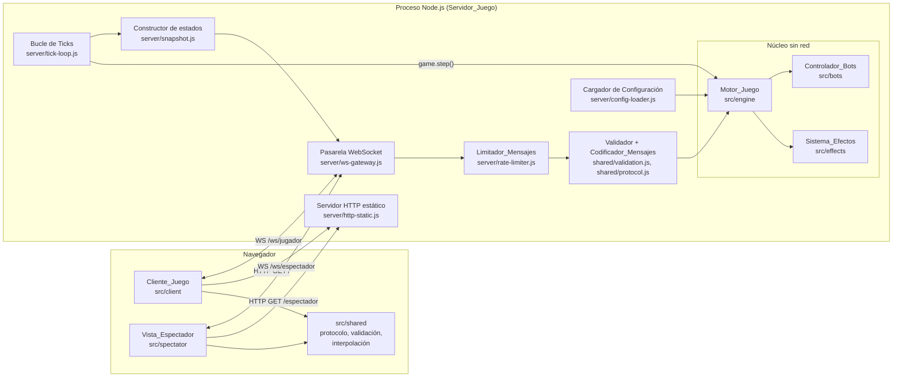
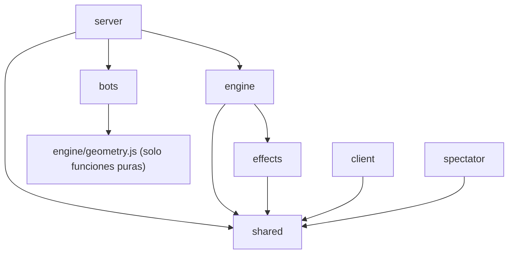
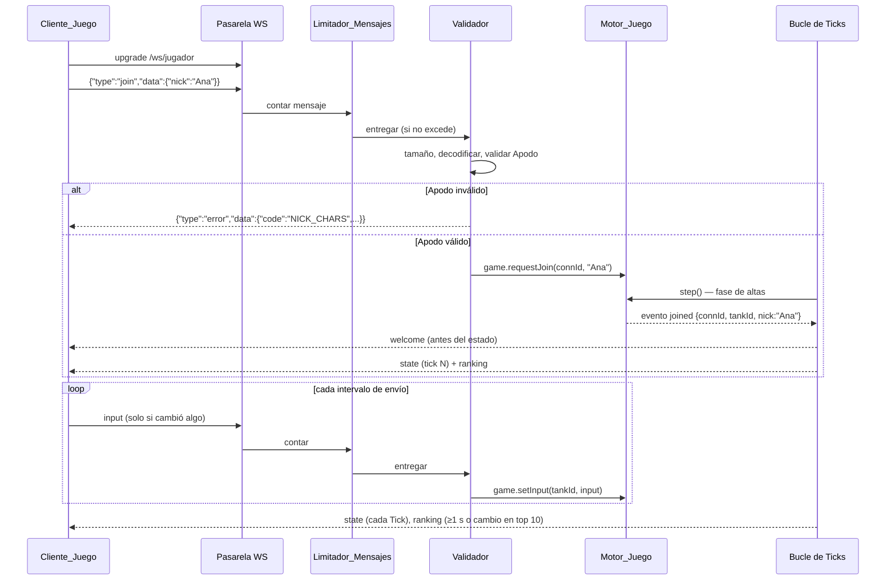

# Documento de Diseño: tank-game-core

## Overview

Este diseño describe el núcleo jugable de un juego web multijugador de tanques con vista cenital. Un único proceso Node.js 24 (módulos ES) sirve por HTTP los archivos del Cliente_Juego y de la Vista_Espectador y, en el mismo puerto, acepta conexiones WebSocket mediante la librería `ws`, que es la única dependencia de ejecución. El servidor es autoritativo: el Motor_Juego avanza la partida a Tick fijo (30 por segundo por defecto) y los clientes solo envían Inputs y dibujan el estado recibido, interpolando entre estados.

Objetivos del diseño, en orden de prioridad:

1. **Correcto y reproducible.** El Motor_Juego es una función determinista de (Configuración, semilla, secuencia de Inputs). No lee el reloj, no usa `Math.random` y recorre las entidades en orden de creación (Req. 24.2, 24.7).
2. **Separado de la red.** El Motor_Juego, el Sistema_Efectos y el Controlador_Bots no importan `ws`, `node:http`, `node:net` ni nada de `src/server/`. Las pruebas crean partidas y avanzan Ticks en memoria (Req. 24.1).
3. **Legible para estudiantes.** Una carpeta por componente del glosario, archivos cortos con una responsabilidad, nombres de código en inglés y comentarios en español, sin paso de compilación (`npm start` ejecuta los fuentes tal cual).
4. **Preparado para sabotajes.** Los Efectos solo tocan la partida mediante el Contexto_Efecto. El registro de Efectos y la estructura de Tablas_Ranking dejan espacio para un futuro cargador de módulos externos y para una tabla de creadores de sabotajes, sin cambiar el protocolo.

Decisiones principales y su justificación:

| Decisión | Alternativas consideradas | Motivo |
|---|---|---|
| Mensajes JSON con números redondeados al construir el estado (posiciones a 0,1 y ángulos a 0,001) | Protocolo binario; JSON sin redondeo | JSON se puede leer en las herramientas del navegador, lo que ayuda a los estudiantes. El redondeo reduce cerca de un 35 % el tamaño del estado sin coste de CPU apreciable. Un formato binario ahorraría otro 60 % pero complica la depuración y el futuro código de sabotajes. Ver "Presupuesto de ancho de banda". |
| Área_Interés por Jugador | Enviar la Arena completa a todos | Con 50 Jugadores y 20 Bots el estado completo ocupa unos 11,5 KB por mensaje; filtrado baja a unos 3 KB (4 veces menos tráfico de salida). |
| Compresión `permessage-deflate` desactivada | Activarla | En `ws` viene desactivada en el servidor porque añade un coste notable de CPU y memoria ([ws README](https://www.npmjs.com/package/ws/v/3.3.2)); en Linux se han descrito problemas graves de fragmentación de memoria ([ws issue #1202](https://github.com/websockets/ws/issues/1202)). Queda como mejora futura. |
| Tanque con área de colisión cuadrada alineada a los ejes (AABB) | Círculo | El movimiento por ejes contra Obstáculos rectangulares es exacto y sencillo con AABB: el punto de contacto de cada eje es una resta. Solo el cañón gira, así que el cuerpo cuadrado no necesita rotar. |
| Rebote de Balas con suma de Minkowski (Obstáculos agrandados por el radio de Bala) y barrido de rayo | Avanzar en subpasos | El barrido es exacto para cualquier velocidad (Req. 8.5) y produce normales alineadas a los ejes, que es justo lo que pide el Req. 8.2. |
| `node:test` + `fast-check` (devDependency) para propiedades | Generador propio con semilla | `fast-check` permite fijar `seed` y `numRuns` por propiedad ([fast-check Configuration](https://fast-check.dev/docs/configuration/)), reduce automáticamente el contraejemplo (shrinking) y ya está probado. Un generador propio sería código adicional que también habría que probar, sin reducción de contraejemplos. Al ser devDependency no cuenta como dependencia de ejecución (Req. 2.2). |
| Comprobación de conexión con frames ping/pong nativos de WebSocket | Mensajes ping/pong de la aplicación | Los navegadores responden al ping nativo de forma automática, así que el Cliente_Juego no necesita código para ello. `ws` expone `ws.ping()` y el evento `pong`. |
| Configuración en un único `config.json` con `value`, `default`, `min` y `max` por parámetro | Archivo JS; valores sueltos | JSON no ejecuta código (más seguro en un servidor público), se valida con `JSON.parse` (Req. 1.7) y deja el rango junto al parámetro (Req. 1.4). |
| Dos límites de tamaño: `maxMessageBytes` (lo aplica la pasarela, descarta y mantiene la conexión) y `maxFrameBytes` (es el `maxPayload` de `ws`, cierra con 1009) | Un único límite en `ws` | `ws` corta la conexión al superar `maxPayload` sin entregar el mensaje, así que no puede aplicar "descartar y seguir". Con dos límites, un cliente torpe pierde un mensaje y un cliente que envía tramas enormes se desconecta sin que el servidor reserve memoria para leerlas (Req. 14.6, 14.9). |
| Área_Visible fija en unidades de Arena (1440 × 900), escalada al Canvas con franjas | Mostrar tantos píxeles de mundo como tenga la ventana | Con el Canvas a tamaño de ventana, un monitor 4K vería cuatro veces más Arena que un portátil, lo que da ventaja injusta y obliga a enviar más entidades. Con un Área_Visible fija todos ven lo mismo y el Área_Interés (1600 × 1000) la cubre siempre (Req. 5.15, 17.14). |
| `targetId` opaco generado con la fuente aleatoria de la partida | Usar el `id` interno; usar el Apodo | El `id` interno es secuencial y revela el orden de creación; el Apodo se libera al desconectarse y otro Jugador puede reutilizarlo. Un valor aleatorio no reutilizado da a los Efectos una clave estable que no filtra nada del Motor_Juego (Req. 22.10–22.12). |

### Presupuesto de ancho de banda

Supuestos: Arena por defecto de 3200 × 2000 unidades, Área_Interés de 1600 × 1000 (una cuarta parte de la Arena), 50 Jugadores y 20 Bots repartidos de forma uniforme, una Bala activa por Tanque de media y 5 Cajas.

Tamaño aproximado de cada entidad en JSON con los números redondeados:

| Entidad | Ejemplo | Bytes |
|---|---|---|
| Tanque | `{"id":17,"nick":"Ana_99","x":812.4,"y":330.1,"angle":1.571,"hp":100,"score":40,"dead":false,"bot":false,"inv":false,"effects":[]}` | ~125 |
| Bala | `{"id":918,"x":900.2,"y":400.7}` | ~32 |
| Caja | `{"id":3,"x":1500,"y":800,"kind":"puntos"}` | ~45 |

| Escenario | Entidades por mensaje | Tamaño | Por Jugador a 30 Hz | Total 50 Jugadores |
|---|---|---|---|---|
| Sin Área_Interés | 70 Tanques, 70 Balas, 5 Cajas | ~11,5 KB | ~345 KB/s | ~17 MB/s (≈ 138 Mbit/s) |
| Con Área_Interés | ~18 Tanques, ~18 Balas, ~1–2 Cajas | ~3,0 KB | ~90 KB/s | ~4,5 MB/s (≈ 36 Mbit/s) |

Sin redondeo, un `double` serializado ocupa hasta 17–18 caracteres (`812.4371928374651`) frente a 5 (`812.4`). Con tres coordenadas por Tanque y dos por Bala, el mensaje crece alrededor de un 50 %. Por eso el constructor de estados (`src/server/snapshot.js`) redondea al construir el mensaje. El Motor_Juego conserva la precisión completa: el redondeo solo afecta a lo que se envía y no altera la simulación ni su reproducibilidad. Codificar 50 mensajes de 3 KB 30 veces por segundo (unos 4,5 MB/s con `JSON.stringify`) está muy por debajo de la capacidad de un núcleo de CPU, de modo que JSON basta. El Ranking viaja aparte, como máximo una vez por Tick y en la práctica alrededor de una vez por segundo, con solo las 10 primeras entradas de cada tabla.

El Área_Visible fija no cambia estas cifras: el Área_Interés sigue siendo de 1600 × 1000 y basta con que cubra el Área_Visible de 1440 × 900 (Req. 5.15). El margen de 80 unidades por lado hace que una entidad que entra por el borde de la pantalla ya esté en el búfer de interpolación del cliente. Como el Área_Visible ya no depende de la ventana, un Jugador con un monitor grande no recibe más entidades que otro con un portátil. El `targetId` no viaja en ningún mensaje, así que tampoco suma bytes.

### Ritmo de Inputs y límite de mensajes

El Cliente_Juego no envía un Input por evento de teclado ni por cuadro dibujado. Acumula los cambios y, al empezar cada intervalo de envío (1/frecuencia de Tick, 33,3 ms por defecto), envía como máximo un Input con el estado más reciente (Req. 17.5, 17.6). Si nada cambió no envía nada (Req. 17.11). El máximo teórico es entonces de 30 mensajes por segundo.

El Limitador_Mensajes permite 90 mensajes por ventana de 1 segundo (3 veces ese máximo). El margen existe porque TCP puede entregar juntos mensajes que el cliente envió en ventanas distintas: tras un corte de red de 1 segundo, un cliente legítimo puede llegar con hasta 60 mensajes acumulados en una sola ventana del servidor. Por eso la Configuración exige al arrancar que el límite sea al menos 2 veces la frecuencia de Tick (Req. 1.10). Un cliente se desconecta solo tras 3 ventanas consecutivas excedidas (Req. 15.3), lo que tolera una ráfaga aislada.

### Decisiones a revisar

Decisiones de diseño que no vienen de los requisitos y que conviene confirmar:

- **Parámetro `tank.size` añadido.** El Req. 1.1 no enumera el tamaño del Tanque, pero el área de colisión lo necesita. Se añade a la Configuración con valor por defecto 40.
- **Esquinas rectas en el rebote de Balas.** La suma de Minkowski con esquinas rectas puede producir un rebote cuando una Bala pasa a menos de 0,41 r de una esquina sin tocarla (ver "Barrido de Balas con rebotes").
- **Orden X antes que Y en el movimiento.** En una esquina el resultado puede diferir del orden contrario; ambos cumplen el Req. 6.6.
- **Comprobación de conexión con ping/pong nativo**, no con mensajes de la aplicación.
- **Nitidez con `devicePixelRatio`.** El Canvas usa un búfer de `innerWidth × dpr` píxeles físicos. Esto no cambia el Área_Visible en unidades de Arena (Req. 17.17), pero en pantallas de densidad 3 multiplica por 9 los píxeles a pintar. Se limita `dpr` a 2.

Quedan resueltas en esta versión, porque los requisitos ya las fijan: la cuenta de instancias del Efecto_Ralentizar usa el Identificador_Objetivo y no el Apodo (Req. 23.3, 23.8–23.10), y el tamaño máximo de trama es un parámetro propio en lugar de un valor derivado (Req. 1.14, 1.15).

### Fuera de alcance

Carga de sabotajes externos, cuentas de usuario, base de datos, soporte para celulares y despliegue en la nube. El diseño reserva los puntos de conexión para el cargador de sabotajes (ver "Sistema_Efectos") y para la segunda Tabla_Ranking.

## Architecture

### Vista de componentes



Dependencias permitidas entre carpetas (las flechas indican "puede importar"):



`engine/`, `effects/` y `bots/` nunca importan `ws`, `node:http`, `node:net` ni `src/server/`. Una prueba recorre el grafo de imports para comprobarlo (Req. 24.1).

### Flujo de una conexión de Jugador



### Bucle de Ticks del servidor

`server/tick-loop.js` ejecuta `game.step()` a paso fijo con un acumulador basado en `performance.now()`. En lugar de `setInterval(fn, 33)` (que en Node redondea a milisegundos enteros y acumula deriva), programa cada Tick en `inicio + n × dt` con `setTimeout(siguiente, max(0, objetivo − ahora))`. Si el proceso se retrasa, ejecuta Ticks seguidos para recuperar, hasta un máximo de 5 por vuelta; si el retraso es mayor, descarta el atraso y registra un aviso. Así el número de Ticks en 10 s se mantiene dentro del ±2 % (Req. 5.1). El Motor_Juego siempre usa `dt = 1 / tickRate`, nunca el tiempo real (Req. 5.6).

Los mensajes de red se procesan entre Ticks, en el bucle de eventos de Node. Nunca modifican directamente las entidades. Solo dejan peticiones en colas del Motor_Juego (altas, bajas, último Input, activaciones de Efectos), que el siguiente Tick consume en un orden fijo.

### Orden de fases dentro de un Tick

`game.step()` ejecuta estas fases siempre en el mismo orden. Dentro de cada fase, los Tanques se recorren por orden de creación y las Balas por orden de creación.

| # | Fase | Qué hace | Criterios |
|---|---|---|---|
| 0 | Instantánea de Líder | Calcula el Ranking con el estado al inicio del Tick y guarda el `id` del Líder (primera entrada de la tabla de tanques, o `null` si está vacía). | 12.2, 12.7, 12.8 |
| 1 | Bajas | Para cada Tanque con baja pendiente (desconexión): finaliza sus Efectos, elimina sus Balas, lo retira de la partida y libera Apodo y plaza. | 16.1, 16.2, 16.5, 16.6, 4.7, 21.7 |
| 2 | Altas | Procesa las solicitudes de entrada en orden de llegada: comprueba el límite de Jugadores, resuelve Apodos duplicados, busca Punto_Seguro, genera el `targetId` y crea el Tanque. Emite `joined` o `rejected`. | 3.1, 3.6, 4.2, 4.8, 22.10, 22.11 |
| 3 | Reapariciones | Reaparece los Tanques eliminados cuyo tiempo de reaparición se cumplió. | 10.1–10.4, 10.6 |
| 4 | Fin de invulnerabilidad por tiempo | Quita la Invulnerabilidad a los Tanques cuyo tiempo de protección terminó. | 10.6 |
| 5 | Activaciones de Efectos | Aplica las activaciones encoladas (validadas al solicitarse) e invoca `onActivate`. | 21.1, 21.5, 23.1 |
| 6 | Inputs de Bots | El Controlador_Bots genera un Input por Bot activo y lo guarda como Input más reciente. | 20.3–20.7 |
| 7 | Input efectivo | Para cada Tanque activo toma su Input más reciente (o el neutro) y lo pasa por los modificadores de Input de sus Efectos. | 5.3, 5.8, 21.3, 22.6 |
| 8 | Orientación y movimiento | Fija el ángulo del cañón y mueve el Tanque por ejes con el Multiplicador_Velocidad vigente. | 6.1–6.9, 22.3, 23.4 |
| 9 | Disparos | Crea Balas en la punta del cañón si la recarga, el máximo de Balas y la punta lo permiten. Al crear una Bala termina la Invulnerabilidad. | 7.1–7.11 |
| 10 | Recogida de Cajas | Asigna cada Caja superpuesta al Tanque que entró antes, suma puntos y emite `boxPicked`. En modo de depuración encola un Efecto_Ralentizar sobre otro Tanque. | 11.4–11.7, 23.6, 23.7 |
| 11 | Avance de Balas | Elimina las Balas que alcanzan su tiempo de vida. Barre las demás con rebotes y guarda su recorrido. Las Balas creadas en este Tick no avanzan. | 8.1–8.8 |
| 12 | Impactos | Recorre las Balas en orden de creación y busca la primera superposición con un Tanque a lo largo de su recorrido. Aplica daño o descarta según invulnerabilidad y daño propio. Elimina las Balas que impactaron o que agotaron sus rebotes. | 9.1, 9.2, 9.5–9.7, 10.7 |
| 13 | Eliminaciones y puntos | Marca como eliminados los Tanques con vida ≤ 0, calcula puntos con el Líder de la fase 0, emite `kill` y finaliza los Efectos de los Tanques eliminados. | 9.3, 9.4, 12.1–12.9, 21.7 |
| 14 | Efectos por Tick | Invoca `onTick` de cada Efecto activo en orden de activación, suma un Tick a su tiempo acumulado y finaliza los Efectos que cumplen su duración. | 21.4, 21.6, 21.8, 21.9 |
| 15 | Aparición de Cajas | Crea una Caja si corresponde según el intervalo y el máximo. | 11.1–11.3 |
| 16 | Cierre | Calcula el Ranking final del Tick, incrementa el contador de Ticks y devuelve los eventos del Tick. | 5.4, 13.1–13.3 |

Notas sobre el orden:

- Las Balas nuevas no avanzan en el Tick en que se crean (aparecen en la punta del cañón), pero sí se comprueban en la fase 12, con un recorrido de longitud cero. Su edad cuenta desde ese Tick.
- La fase 9 va antes que la 12, así que una Bala creada por un Tanque invulnerable le quita la protección antes de los impactos de ese mismo Tick (Req. 7.10).
- El modificador de Input (fase 7) y `onTick` (fase 14) de un Efecto activado en la fase 5 ya actúan en ese mismo Tick, después de `onActivate` (Req. 21.5). Como `onActivate` se ejecuta antes del movimiento, el Efecto_Ralentizar frena al Tanque desde el primer Tick que procesa la activación (Req. 23.1).
- El Multiplicador_Velocidad que se fija en `onTick` (fase 14) se usa en el movimiento del Tick siguiente. Es "el último valor fijado antes del paso de movimiento" (Req. 22.3).

## Components and Interfaces

### Estructura de carpetas

```
/
├── package.json          "type": "module", engines.node ">=24", scripts start/test,
│                         dependencies: { ws }, devDependencies: { fast-check }
├── config.json           Configuración única (valor, por defecto y rango de cada parámetro)
├── README.md             Una línea por carpeta + qué hacen npm start y npm test
├── src/
│   ├── engine/           Motor_Juego (sin red)
│   │   ├── game.js           createGame(): API pública y orden de fases de step()
│   │   ├── tanks.js          creación, Input neutro, reaparición, invulnerabilidad
│   │   ├── movement.js       dirección WASD y movimiento por ejes
│   │   ├── bullets.js        disparo, barrido con rebotes, tiempo de vida
│   │   ├── hits.js           impactos de Balas contra Tanques
│   │   ├── scoring.js        puntos por eliminación, Líder y pérdida al morir
│   │   ├── boxes.js          aparición y recogida de Cajas
│   │   ├── spawn.js          búsqueda de Punto_Seguro
│   │   ├── nicknames.js      resolución de Apodos duplicados
│   │   ├── ranking.js        computeRanking(): Tablas_Ranking ordenadas
│   │   ├── geometry.js       AABB, rayo contra AABB, segmento contra rectángulo redondeado
│   │   └── rng.js            mulberry32(seed): fuente aleatoria con semilla
│   ├── effects/          Sistema_Efectos
│   │   ├── effect-system.js  registro, ciclo de vida y Puntos_Extensión
│   │   ├── effect-context.js createEffectContext(): API limitada
│   │   └── builtin/
│   │       └── slow.js       Efecto_Ralentizar
│   ├── bots/             Controlador_Bots
│   │   └── bot-controller.js
│   ├── server/           Servidor_Juego (red y HTTP)
│   │   ├── main.js           punto de entrada: comprueba la versión de Node y carga start.js
│   │   ├── start.js          carga la Configuración, crea la partida, abre el puerto
│   │   ├── config-loader.js  lectura y validación de config.json
│   │   ├── config-schema.js  lista de parámetros, tipos y valores de respaldo
│   │   ├── http-static.js    archivos estáticos con lista blanca y 404
│   │   ├── ws-gateway.js     conexiones, enrutado jugador/espectador, envío
│   │   ├── rate-limiter.js   Limitador_Mensajes (reloj inyectable)
│   │   ├── heartbeat.js      ping/pong y cierre por inactividad
│   │   ├── snapshot.js       Área_Interés, mensajes de estado y de Ranking
│   │   └── tick-loop.js      bucle a paso fijo
│   ├── shared/           código compartido cliente/servidor (servido en /shared/)
│   │   ├── protocol.js       Codificador_Mensajes: tipos, esquemas, encode/decode
│   │   ├── validation.js     Validador: Apodo e Input
│   │   ├── interpolation.js  búfer de estados e interpolación
│   │   └── math.js           normalizeAngle, lerp, lerpAngle, clampWindow
│   ├── client/           Cliente_Juego (servido en /)
│   │   ├── index.html
│   │   ├── main.js           pantallas, conexión, bucle de dibujo
│   │   ├── input-sampler.js  agrupación de Inputs por intervalo de envío
│   │   ├── camera.js         cámara que sigue al Tanque y respeta los bordes
│   │   ├── render.js         dibujo en Canvas
│   │   └── hud.js            Ranking, cuenta regresiva, aviso de desconexión
│   └── spectator/        Vista_Espectador (servida en la ruta de la Configuración)
│       ├── index.html
│       ├── main.js           conexión y reconexión cada 3 s
│       ├── render.js         Arena completa con escala única
│       └── kill-feed.js      avisos de eliminación (5 s, máximo 5)
└── test/                 pruebas (node:test), espejo de src/
    ├── engine/  effects/  bots/  server/  shared/  client/
    ├── properties/       pruebas de propiedades con fast-check
    └── helpers/          fábricas de Configuración y partidas de prueba
```

`input-sampler.js` y `camera.js` son módulos puros sin acceso al DOM, así que `node:test` puede importarlos desde `test/client/`.

### Motor_Juego (`src/engine/game.js`)

```js
/**
 * Crea una partida. No abre puertos ni lee archivos.
 * @param {object} opts
 * @param {GameConfig} opts.config     Configuración ya validada
 * @param {() => number} opts.rng      fuente aleatoria en [0, 1) (p. ej. mulberry32(seed))
 * @param {BotController} [opts.bots]  opcional; las pruebas pueden omitirlo
 * @param {(msg: string) => void} [opts.log]
 */
export function createGame({ config, rng, bots, log }) → Game
```

| Método de `Game` | Descripción |
|---|---|
| `requestJoin(connId, nick)` | Encola una alta con un Apodo ya validado y sin espacios en los extremos. Si `connId` ya tiene Tanque o alta pendiente, la descarta y devuelve `false` (Req. 3.8). |
| `requestLeave(connId)` | Encola la baja del Tanque de `connId` para la fase 1 del siguiente Tick. |
| `setInput(tankId, input)` | Guarda el Input como Input más reciente si el Tanque está activo. Si está eliminado lo descarta (Req. 7.7). Reemplaza el anterior sin acumular (Req. 5.3). |
| `addBot(nick)` | Crea un Bot en un Punto_Seguro (lo usa el Controlador_Bots al arrancar). |
| `activateEffect(effectDef, targetTankId, durationMs)` | Valida y encola una activación. Devuelve `{ ok: true, effectId }` o `{ ok: false, error }` (Req. 21.1, 21.2). |
| `step()` | Ejecuta un Tick completo y devuelve `TickResult` (ver Data Models). |
| `getView()` | Vista de solo lectura del estado actual (copias), para el constructor de estados y las pruebas. |
| `getRanking()` | Último Ranking calculado. |
| `getStaticInfo()` | Dimensiones de la Arena y lista de Obstáculos. |

`createGame` solo usa `config` y `rng`. Cualquier otra fuente de no determinismo está prohibida en `src/engine/`, `src/effects/` y `src/bots/`. Una prueba revisa que esas carpetas no contengan `Math.random`, `Date.now`, `performance.now` ni `crypto`.

### Algoritmo: Identificador_Objetivo (`tanks.js`)

Cada Tanque (de Jugador o Bot) recibe al crearse un `targetId` de texto, en el mismo Tick y antes de que pueda activarse ningún Efecto sobre él (Req. 22.10):

```
newTargetId(world, rng):
  repetir:
    hi = floor(rng() × 2^32); lo = floor(rng() × 2^32)       // 64 bits de la fuente de la partida
    id = "t_" + hex8(hi) + hex8(lo)                           // p. ej. "t_9f3a01c2e47b5d10"
    si id no está en world.issuedTargetIds: salir             (Req. 22.11)
  world.issuedTargetIds.add(id)
  devolver id
```

- No se calcula a partir de `id`, `joinSeq` ni el Apodo, así que no revela el orden de creación ni la identidad del Jugador (Req. 22.10).
- `issuedTargetIds` es un `Set` de la partida que nunca se vacía. Guarda también los identificadores de Tanques retirados, de modo que un Jugador que vuelve con el mismo Apodo recibe un valor distinto (Req. 22.11, 22.14). Con 64 bits la probabilidad de colisión es despreciable; el bucle existe para que la unicidad sea una garantía y no una probabilidad. Con 200 Jugadores y miles de altas, el `Set` ocupa unos pocos cientos de KB como mucho.
- El campo se asigna una vez y nunca se reescribe: la reaparición, la eliminación y la resolución de Apodos no lo tocan (Req. 22.12).
- **Determinismo.** Generar el identificador consume dos (o más, si hay colisión) valores de `rng` por alta, en la fase 2 y en orden de llegada. Eso desplaza los valores que reciben después la búsqueda de Punto_Seguro, las Cajas y los Bots, pero la secuencia sigue dependiendo solo de (semilla, Configuración, operaciones), así que dos partidas iguales producen los mismos `targetId` y el mismo estado (Req. 24.7). Para que la posición del Tanque no dependa de si hubo colisión, el identificador se genera después de buscar el Punto_Seguro.
- El `targetId` no sale del Motor_Juego salvo por `ctx.getTargetId()`. `getView()` lo incluye en sus copias, porque las pruebas lo necesitan, y `snapshot.js` construye los mensajes con una lista blanca de campos que no lo contiene (Req. 22.13).

### Algoritmo: movimiento de Tanques por ejes (`movement.js`)

El área de colisión del Tanque es un cuadrado alineado a los ejes de lado `tank.size` (40 por defecto), centrado en `(x, y)`. Se añade el parámetro `tank.size` a la Configuración porque el Req. 1.1 no lo enumera y el diseño lo necesita.

1. Dirección: `dx = (D ? 1 : 0) − (A ? 1 : 0)`, `dy = (S ? 1 : 0) − (W ? 1 : 0)` (el eje y crece hacia el borde inferior). Las teclas opuestas se anulan solas (Req. 6.2, 6.4). Si `(dx, dy) = (0, 0)` no hay movimiento (Req. 6.5). Si no, se normaliza: `len = hypot(dx, dy)`, dirección `(dx/len, dy/len)` (Req. 6.3).
2. Distancia del Tick: `d = tankSpeed × speedMultiplier / tickRate` (Req. 6.1).
3. Eje X: desplazamiento deseado `mx = dirX × d`. Si `mx > 0`, el límite es `min(arenaW, bordeIzquierdo de cada Obstáculo con o.left ≥ tankRight y solape estricto en Y)`; la nueva posición es `min(x + mx, límite − half)`. El caso `mx < 0` es simétrico. Como se busca el Obstáculo más cercano en todo el recorrido (no solo en el punto final), el Tanque no atraviesa paredes delgadas aunque `d` sea mayor que su grosor (Req. 6.8).
4. Eje Y: igual que el eje X, usando la X ya actualizada.
5. Al tocar, la posición queda exactamente en `límite − half` (sin épsilon), y "superposición" se define como solape estricto (`>`), de modo que tocar no es superponerse.

Resolver X antes que Y implica que, en una esquina, el resultado puede diferir de resolver Y antes que X. Es aceptable: ambos cumplen el Req. 6.6 y el orden fijo mantiene el determinismo. Si un eje está bloqueado, el otro aplica su desplazamiento completo (Req. 6.6). Si ambos lo están, el Tanque queda en contacto en ambos (Req. 6.7).

Ángulo del cañón: `angle = normalizeAngle(input.aim)`, con `normalizeAngle(a) = a − 2π × floor((a + π) / (2π))`, que devuelve un valor en [−π, π) (Req. 6.9).

### Algoritmo: disparo (`bullets.js`)

Para cada Tanque activo con `input.fire = true`, en orden de creación:

1. `ticksDesde = tick − lastShotTick`, o ∞ si `lastShotTick = null` (Tanque recién creado o reaparecido, Req. 7.8). Si `ticksDesde / tickRate < reloadMs / 1000`, se ignora (Req. 7.3, 7.4). Para evitar errores de coma flotante se compara en Ticks enteros: `ticksDesde ≥ ceil(reloadMs × tickRate / 1000)`.
2. Si el número de Balas propias activas es igual a `maxActiveBullets`, se ignora (Req. 7.6).
3. Punta del cañón: `tip = (x + cos(aim) × barrelLength, y + sin(aim) × barrelLength)`. Si el círculo de la Bala en `tip` se superpone con un Obstáculo agrandado o queda fuera de `[r, W − r] × [r, H − r]`, se ignora (Req. 7.9). Así ninguna Bala nace dentro de una Pared (Req. 8.5).
4. Se crea la Bala `{ id, ownerId, ownerNick, ownerLife, x, y, vx, vy, bounces: 0, bornTick: tick }`, con `(vx, vy) = (cos(aim), sin(aim)) × bulletSpeed`. Se guarda `lastShotTick = tick`.
5. Si el Tanque era invulnerable, la invulnerabilidad termina ahora (Req. 7.10). Si el disparo se ignoró en los pasos 1 a 3, la invulnerabilidad no cambia (Req. 7.11).

El disparo mantenido crea una Bala cada vez que se cumple la recarga, sin exigir soltar el botón (Req. 7.5).

### Algoritmo: barrido de Balas con rebotes (`bullets.js`, `geometry.js`)

La Bala es un círculo de radio `r`. En vez de comprobar un círculo contra rectángulos, se usa la suma de Minkowski: el centro de la Bala es un punto, cada Obstáculo se agranda `r` por cada lado y los bordes de la Arena se contraen `r`. Las esquinas del rectángulo agrandado son rectas, no redondeadas. Esto puede producir un rebote cuando la Bala pasa a menos de `r(√2 − 1) ≈ 0,41 r` de una esquina sin tocarla. Se acepta a cambio de normales siempre alineadas a los ejes, que es exactamente "invertir la componente perpendicular a la Pared" (Req. 8.2).

```
advanceBullet(b):
  si tick − b.bornTick ≥ round(bulletLifetimeS × tickRate): eliminar; return   (Req. 8.6)
  restante = bulletSpeed / tickRate                                             (Req. 8.1)
  path = [{ from: (b.x, b.y), bounces: b.bounces }]
  repetir:
    hit = primerContacto((b.x, b.y), dir(b), restante)    // menor t en (ε, restante]
    si no hay hit: mover restante; cerrar segmento; salir
    mover hasta hit.point; restante −= hit.t; cerrar segmento
    si b.bounces == maxBounces: marcar b para eliminar en el punto de contacto; salir   (Req. 8.3)
    si hit.esEsquina: vx = −vx; vy = −vy                  (Req. 8.8)
    si no, si hit.normal es X: vx = −vx; si no: vy = −vy  (Req. 8.2)
    b.bounces += 1
    abrir nuevo segmento desde hit.point con bounces = b.bounces
```

`primerContacto` prueba el rayo contra las cuatro líneas del borde contraído y contra cada Obstáculo agrandado con el método de "slabs" (intersección de intervalos en X e Y). El contacto de entrada de cada Obstáculo da `t` y el eje de la cara tocada. Si `|tX − tY| ≤ 1e−9`, el contacto es una esquina. Si dos Paredes distintas dan el mismo `t` en ejes distintos (por ejemplo, el borde de la Arena y un Obstáculo pegado a él), también se trata como esquina. Los contactos se procesan en orden de `t` creciente, cada uno como un rebote independiente (Req. 8.7). Al reflejar solo se cambia el signo de una componente, así que la rapidez se conserva exactamente (Req. 8.4). El `ε = 1e−9` evita volver a detectar la Pared de la que se acaba de salir. Para no entrar en un bucle infinito, el número de contactos por Tick está acotado por `maxBounces + 1`, porque el contacto siguiente al último rebote elimina la Bala.

El recorrido (`path`, una lista de segmentos con su contador de rebotes) se guarda en la Bala solo durante el Tick, para la fase de impactos.

### Algoritmo: impactos (`hits.js`)

Una Bala se superpone con un Tanque cuando la distancia entre el centro de la Bala y el cuadrado del Tanque es ≤ `r` (Req. 9.1). En un recorrido, esto equivale a que el segmento toque el "rectángulo redondeado" (el cuadrado agrandado `r` con esquinas de radio `r`). `segmentHitsRoundedRect(seg, aabb, r)` devuelve el menor parámetro `t` de contacto, como el mínimo entre el segmento contra el rectángulo agrandado solo en X, contra el agrandado solo en Y y contra los cuatro círculos de las esquinas. Esto es exacto para cualquier velocidad de Bala, así que una Bala rápida no atraviesa un Tanque sin tocarlo.

```
para cada Bala b en orden de creación:
  para cada segmento s de b.path, en orden:
    candidatos = Tanques activos t (no eliminados en este Tick) con contacto en s
    descartar t == emisor si s.bounces == 0, o si selfDamage == false,
                o si b.ownerLife != t.life                        (Req. 9.6, 10.1)
    si hay candidatos: tomar el de menor t de contacto (empate: el creado antes)
       si es invulnerable: eliminar b sin daño                     (Req. 9.5, 10.7)
       si no: t.hp −= damage; registrar (b.ownerId, b.ownerNick) como último impacto; eliminar b
       si t.hp ≤ 0: t.hp = 0; marcar t "eliminado en este Tick"    (Req. 9.3)
       pasar a la siguiente Bala
  si b estaba marcada por agotar rebotes: eliminar b               (Req. 8.3)
```

Como las Balas se procesan por orden de creación, los impactos sobre un mismo Tanque también siguen ese orden. Cuando un Tanque queda eliminado, las Balas siguientes no lo consideran y siguen su camino (Req. 9.7). `ownerLife` es el número de vida del emisor al disparar: tras reaparecer, sus Balas antiguas ya no le hacen daño propio, aunque sí a los demás Tanques (Req. 10.1).

### Algoritmo: eliminación y puntuación (`scoring.js`)

Para cada Tanque eliminado en este Tick, en el orden en que se eliminaron:

1. `lost = floor(score × deathLossPercent / 100)`; `score −= lost` (Req. 12.3). Como `0 ≤ lost ≤ score`, los puntos siguen siendo enteros ≥ 0 (Req. 12.5).
2. El autor es el emisor de la Bala que hizo llegar la vida a 0. Si el autor es el propio Tanque, no gana puntos (Req. 12.4). Si el autor ya no está en la partida, nadie gana puntos (Req. 12.6). Si no, el autor gana `killPoints`, más `leaderBonus` si `victim.id == leaderIdAlInicioDelTick` (Req. 12.1, 12.2, 12.7). El Líder se toma de la tabla de tanques de la fase 0, que solo contiene Tanques elegibles. Así, con la opción bots en el ranking desactivada, eliminar un Bot nunca da la bonificación, y si la tabla está vacía no hay Líder (Req. 12.8). Los Bots ganan y pierden puntos igual que los Jugadores (Req. 12.9, 20.11).
3. Marcar `dead = true`, `deadTick = tick`, `deathPos = (x, y)`, `lastInput = INPUT_NEUTRO` (Req. 7.7) y emitir `kill { victimNick, killerNick }` con el Apodo guardado en la Bala, que sigue disponible aunque el autor se haya desconectado (Req. 9.4).
4. Finalizar los Efectos cuyo objetivo es el Tanque (Req. 21.7).

### Algoritmo: Punto_Seguro (`spawn.js`)

```
findSafePoint(world, rng, maxAttempts):
  mejor = null
  repetir maxAttempts veces:
    p = (half + rng() × (W − 2·half), half + rng() × (H − 2·half))
    si el cuadrado del Tanque en p se superpone con algún Obstáculo: continuar
    dMin = distancia mínima entre centros a cualquier Tanque activo (∞ si no hay)
    si dMin ≥ safeDistance: devolver p                          (Req. 10.3)
    si mejor es null o dMin > mejor.dMin: mejor = { p, dMin }
  si mejor: devolver mejor.p                                    (Req. 10.4)
  devolver escaneoDeRespaldo()
```

`escaneoDeRespaldo` recorre una cuadrícula de paso `tank.size` y devuelve la primera celda libre de Obstáculos. Al arrancar, `config-loader` comprueba que exista al menos una celda libre, así que este caso nunca se queda sin posición. Las Cajas usan el mismo esquema con su tamaño, y además evitan superponerse con Tanques activos y con otras Cajas. Si no encuentran posición en `boxMaxAttempts` intentos, omiten la creación (Req. 11.2, 11.3).

### Cajas (`boxes.js`)

- Aparición: `ref = max(lastBoxSpawnTick, belowMaxSinceTick)`. Cuando `boxes.length < boxMax` y `tick − ref ≥ round(boxIntervalS × tickRate)`, se intenta crear una Caja y se guarda `lastBoxSpawnTick = tick`, tanto si se creó como si no. Así, si falla, se reintenta en el siguiente intervalo (Req. 11.1, 11.3). `belowMaxSinceTick` se actualiza en el Tick en que el número de Cajas baja desde el máximo.
- Recogida: para cada Caja, entre los Tanques activos (invulnerables incluidos) cuyo cuadrado se superpone con el de la Caja, gana el de menor `joinSeq`. Suma `boxPoints`, elimina la Caja y emite `boxPicked { tankId, kind: "puntos" }` (Req. 11.4–11.7).

### Ranking (`ranking.js`)

```js
/** Función pura. tanks: [{ id, nick, score, isBot, joinSeq }] */
export function computeRanking(tanks, { botsInRanking }) →
  { tables: [{ name: "tanques", entries: [{ position, id, nick, score, isBot }] }] }
```

Filtra los Tanques elegibles (todos los de Jugador y, solo si `botsInRanking`, también los Bots; Req. 13.10, 13.11). Ordena por `score` descendente y, en empate, por `joinSeq` ascendente. `joinSeq` es un contador global que se asigna al crear el Tanque y no cambia al reaparecer (Req. 13.1). Numera las posiciones 1..n (Req. 13.2). Los Tanques eliminados en espera siguen en la tabla y los retirados por desconexión ya no están (Req. 13.3).

`tables` es una lista de objetos con nombre. Un spec posterior añadirá `{ name: "creadores", entries: [...] }` sin cambiar el formato del mensaje (Req. 13.8). Las entradas de esa tabla podrán representar personas en lugar de Tanques; por eso cada entrada lleva `nick`, `score` e `isBot`, y no depende de campos propios de un Tanque.

### Controlador_Bots (`src/bots/bot-controller.js`)

```js
export function createBotController({ config, rng }) → {
  init(game),                  // crea config.bots.count Bots: "Bot 1" ... "Bot N" (Req. 20.1, 20.9)
  inputsFor(view) → Map<tankId, Input>   // exactamente un Input por Bot activo (Req. 20.3)
}
```

El Motor_Juego llama a `inputsFor` en la fase 6 con una vista de solo lectura y usa la misma fuente `rng` de la partida (Req. 20.6). Estado de cada Bot: `{ moveDir (una de 8), target: {x, y}, targetSinceTick }`.

En cada Tick:

1. **Objetivo visible.** Entre los Tanques activos distintos del Bot a distancia ≤ `visionRange`, con línea de visión libre (`segmentIntersectsAabb` contra cada Obstáculo es falso), se toma el más cercano (empate: menor `joinSeq`). Si existe, `aim = atan2(dy, dx)` y `fire = true` (Req. 20.5). Si no, `fire = false` (Req. 20.6).
2. **Destino.** Si la distancia al destino es ≤ `arriveDistance`, o `tick − targetSinceTick ≥ targetTimeoutS × tickRate`, se elige un nuevo destino aleatorio libre de Obstáculos con `rng` (Req. 20.7).
3. **Dirección.** `moveDir` es la de las 8 direcciones WASD con menor diferencia angular respecto al vector hacia el destino. Mientras dispara, el Bot sigue moviéndose hacia su destino, para que no quede quieto y sea un blanco fácil.
4. **Esquivar.** Si un rayo desde el centro en `moveDir`, de longitud `half + detectDistance`, toca una Pared (Obstáculo o borde), se prueban las 8 direcciones en orden fijo, empezando por la más cercana al destino, y se toma la primera libre. Si ninguna está libre, se usa la opuesta a la actual (Req. 20.4).
5. Se construye `{ w, a, s, d, fire, aim }` a partir de `moveDir`. Este Input siempre pasa `validateInput` (Req. 20.3). Mientras el Bot está eliminado no se generan Inputs (Req. 20.8).

### Sistema_Efectos (`src/effects/`)

#### Definición de un Efecto

Un Efecto es un objeto con nombre y una fábrica. Cada activación llama a `create()` y obtiene sus propias funciones con su propio estado (en un cierre), de modo que dos activaciones del mismo Efecto son independientes (Req. 21.1).

```js
export const exampleEffect = {
  name: "ejemplo",
  create() {
    return {
      onActivate(ctx) { ... },          // opcional
      modifyInput(ctx, input) { ... },  // opcional; devuelve un Input
      onTick(ctx) { ... },              // opcional
      onEnd(ctx) { ... },               // opcional
    };
  },
};
```

#### API del Sistema_Efectos (uso interno del Motor_Juego)

| Función | Punto_Extensión / uso |
|---|---|
| `request(def, targetId, durationMs, tick)` | Valida (duración entera en [1, `maxDurationMs`]; objetivo presente y activo) y encola. Devuelve `{ ok, effectId }` o `{ ok: false, error: "DURATION_NOT_INTEGER" \| "DURATION_OUT_OF_RANGE" \| "TARGET_NOT_FOUND" \| "TARGET_ELIMINATED" }`. Si al aplicar la activación en la fase 5 el objetivo ya no está activo, se descarta y se registra en el log. |
| `applyPending()` | Fase 5: crea los Efectos activos en orden de solicitud (`activationSeq` creciente) e invoca `onActivate`. |
| `modifyInput(tankId, input)` | Fase 7: encadena los `modifyInput` de los Efectos del Tanque por `activationSeq`. |
| `tickAll()` | Fase 14: `onTick`, `elapsedTicks += 1` y expiración. |
| `endForTarget(tankId)` | Fases 1 y 13: finaliza todos los Efectos del Tanque. |
| `activeFor(tankId)` | Para el estado: `[{ name, remainingMs }]`. |

Reglas del ciclo de vida:

- `elapsedMs = elapsedTicks × 1000 / tickRate`. Cuando `elapsedMs ≥ durationMs`, se invoca `onEnd` y se retira el Efecto en la misma fase (Req. 21.6). `remainingMs = max(0, ceil(durationMs − elapsedMs))` (Req. 21.10). Se redondea hacia arriba para que un Efecto todavía activo nunca muestre 0 ms.
- Cada invocación va dentro de `try/catch`. Si `onActivate`, `modifyInput` u `onTick` lanzan una excepción, se registra `[efecto <nombre>] <error>`, se invoca `onEnd` una vez (también protegido) y se retira el Efecto. El siguiente modificador recibe el Input que había recibido el que falló (Req. 21.8). Si `onEnd` lanza una excepción, se registra y el Efecto se retira sin reintentar (Req. 21.9).
- Validación del valor que devuelve `modifyInput`: debe ser un objeto con `w, a, s, d, fire` booleanos y `aim` numérico finito. Si no lo es, se ignora y la cadena continúa con el Input anterior (Req. 22.6). Se reutiliza `validateInput` de `shared/validation.js`. El resultado se copia campo a campo, de modo que un Efecto no puede colar campos extra ni conservar referencias.
- Un Efecto finalizado queda marcado `retired = true` justo después de su `onEnd`. A partir de ahí su Contexto_Efecto ignora las escrituras (Req. 22.8). La marca se pone después de `onEnd` para que `onEnd` todavía pueda restaurar el Multiplicador_Velocidad.

#### Contexto_Efecto (`effect-context.js`)

Se crea uno por activación. Es un objeto congelado (`Object.freeze`) cuyos métodos cierran sobre una referencia interna al Tanque que el Efecto no puede ver:

| Método | Devuelve / efecto |
|---|---|
| `getPosition()` | `{ x, y }`, un objeto nuevo en cada llamada |
| `getHealth()`, `getScore()`, `getNick()` | número / número / texto (primitivos) |
| `getTargetId()` | texto: el Identificador_Objetivo del Tanque objetivo. Todos los contextos sobre el mismo Tanque devuelven el mismo valor (Req. 22.2) |
| `getTick()` | número de Tick actual |
| `getRemainingMs()` | entero ≥ 0 |
| `getSpeedMultiplier()` | número |
| `setSpeedMultiplier(v)` | Si `v` no es un número finito: rechaza, conserva el valor y registra el error con el nombre del Efecto (Req. 22.7). Si es finito: guarda `clamp(v, min, max)` (Req. 22.3, 22.5). Si el Efecto está retirado, no hace nada (Req. 22.8). |

Las consultas devuelven primitivos o copias nuevas, así que modificar lo devuelto no altera el Motor_Juego (Req. 22.4). El contexto no expone el Motor_Juego, ni otros Tanques, ni Balas, Cajas o Ranking (Req. 22.1, 22.2). El Input que recibe `modifyInput` también es una copia.

Ningún método recibe un identificador como argumento: todas las consultas y escrituras actúan sobre el Tanque objetivo fijado al crear el contexto (Req. 22.9). El `targetId` sirve a un Efecto para reconocer a su objetivo entre activaciones (como clave de un `Map`), pero no permite consultar ni modificar otro Tanque, porque no existe ninguna operación que lo acepte. Una prueba comprueba que el contexto tiene exactamente las claves de esta tabla y que cada método tiene aridad 0, salvo `setSpeedMultiplier`, que tiene aridad 1.

#### Efecto_Ralentizar (`builtin/slow.js`)

La definición se crea con una fábrica, `createSlowEffect({ factor })`, que guarda en su cierre un `Map<targetId, count>` compartido por todas las instancias de esa definición. El Motor_Juego crea una definición por partida, así que la cuenta no es global del módulo y dos partidas en la misma prueba no comparten estado.

```js
export function createSlowEffect({ factor }) {
  const active = new Map();                     // targetId → instancias activas
  return {
    name: "ralentizar",
    create() {
      return {
        onActivate(ctx) {
          const id = ctx.getTargetId();
          active.set(id, (active.get(id) ?? 0) + 1);      // Req. 23.8
          ctx.setSpeedMultiplier(factor);                  // Req. 23.1
        },
        onEnd(ctx) {
          const id = ctx.getTargetId();
          const n = (active.get(id) ?? 1) - 1;
          if (n <= 0) { active.delete(id); ctx.setSpeedMultiplier(1); }  // Req. 23.3, 23.9
          else { active.set(id, n); ctx.setSpeedMultiplier(factor); }
        },
      };
    },
  };
}
```

- `onEnd` se ejecuta en los tres casos de fin (duración cumplida, objetivo eliminado y objetivo retirado; Req. 21.6, 21.7, 16.2), así que la cuenta vuelve siempre a 0 cuando no quedan instancias.
- La clave es el `targetId` y no el Apodo. Como un Tanque nuevo recibe siempre un `targetId` nunca usado, empieza sin instancias aunque herede el Apodo de un Tanque retirado (Req. 23.10). Las cuentas de Tanques distintos son entradas distintas del `Map`.
- Borrar la entrada al llegar a 0 (Req. 23.9) mantiene el `Map` del tamaño del número de objetivos ralentizados en ese momento.
- Alternativa descartada: añadir al Contexto_Efecto una consulta "cuántos Efectos de este nombre hay sobre mi objetivo". Ampliaría la API limitada más allá del Req. 22.2.

Modo de depuración (Req. 23.6, 23.7): en la fase 10, por cada evento `boxPicked`, si `config.debug` es verdadero, se eligen los Tanques activos distintos del que recogió la Caja, ordenados por `joinSeq`. Si hay alguno, se toma `candidatos[floor(rng() × n)]` y se solicita la definición del Efecto_Ralentizar de la partida con `config.effects.slow.durationMs`. La activación se aplica en la fase 5 del Tick siguiente. Si no hay candidatos, no se hace nada y la recogida ya está contabilizada.

#### Espacio para el futuro cargador de sabotajes

`game.activateEffect(def, targetId, durationMs)` es la única puerta de entrada y no depende de dónde venga `def`. El futuro cargador solo tendrá que importar módulos que exporten `{ name, create }`, comprobar su forma y llamar a `activateEffect`. El aislamiento de código no confiable (por ejemplo, con `worker_threads` o `node:vm` y límites de tiempo) queda para ese spec. Este diseño solo garantiza que el contrato del Efecto no expone nada fuera del Contexto_Efecto. El evento `boxPicked` con su `kind` es el disparador previsto para las Cajas de sabotaje.

### Servidor_Juego (`src/server/`)

#### Arranque (`main.js`, `start.js`)

1. `main.js` lee `process.versions.node`. Si la versión mayor es menor que 24, escribe `Se requiere Node.js 24 o superior (versión actual: X)` y sale con código 1 (Req. 2.8). Solo después hace `await import("./start.js")`, para que ningún import de `start.js` pueda fallar antes de esta comprobación.
2. `config-loader.js` lee `config.json` (ver Data Models) y lo valida. Si hay errores, los muestra todos en consola y sale con código 1 sin abrir el puerto (Req. 1.5–1.13).
3. Crea `rng = mulberry32(seed)` con `seed = Date.now() >>> 0` (solo el servidor lee el reloj), el Controlador_Bots y la partida, y llama a `bots.init(game)`.
4. Crea el `http.Server` y el `WebSocketServer({ noServer: true, maxPayload: config.network.maxFrameBytes, perMessageDeflate: false })`, y enruta el evento `upgrade` por ruta: `/ws/jugador` o `/ws/espectador`. Cualquier otra ruta recibe `socket.destroy()`.
5. `server.listen(port)`. Si da `EADDRINUSE`, muestra `El puerto <p> está ocupado por otro proceso` y sale con código 1 (Req. 2.6). Al escuchar, muestra `Juego: http://localhost:<p>/` y `Espectador: http://localhost:<p><spectatorPath>` (Req. 2.5) e inicia el bucle de Ticks.

Hay dos límites de tamaño, ambos de la Configuración:

- **`maxFrameBytes`** (tamaño máximo de trama, 65536 por defecto) es directamente el `maxPayload` de `ws`. `ws` comprueba la longitud declarada en la cabecera de la trama antes de leer la carga útil. Si la supera, cierra la conexión con el código 1009 sin reservar memoria para el contenido ni entregarlo a la aplicación (Req. 14.9). La pasarela recibe el evento `close` con código 1009, registra el cierre con el `connId` y llama a `game.requestLeave(id)`, igual que en cualquier otra desconexión (Req. 16.1).
- **`maxMessageBytes`** (tamaño máximo de mensaje, 1024 por defecto) lo aplica la pasarela a los mensajes ya recibidos: los descarta antes de decodificarlos y mantiene la conexión (Req. 14.6).

El arranque exige `maxFrameBytes ≥ maxMessageBytes` (Req. 1.15). Con la igualdad, ningún mensaje cae en la franja "descartar y seguir": todo lo que supere el límite cierra la conexión.

#### Archivos estáticos (`http-static.js`)

Solo atiende `GET` y `HEAD`. Tabla de rutas:

| Ruta | Archivo |
|---|---|
| `/` | `src/client/index.html` |
| `/<archivo>` | `src/client/<archivo>` |
| `<spectatorPath>` (por defecto `/espectador`) | `src/spectator/index.html` |
| `<spectatorPath>/<archivo>` | `src/spectator/<archivo>` |
| `/shared/<archivo>` | `src/shared/<archivo>` |

Se decodifica la ruta y se resuelve con `path.resolve`. Si el resultado no empieza por la carpeta base, o la extensión no está en `{.html, .js, .css, .png, .svg, .ico}`, se responde 404 (Req. 2.7). Así se impide salir de la carpeta con `../`. La respuesta lleva `Content-Type` según la extensión y `X-Content-Type-Options: nosniff`. Los errores de lectura responden 404 o 500 sin afectar a la partida.

#### Pasarela WebSocket (`ws-gateway.js`)

Cada conexión se representa con `Connection { id, role: "player" | "spectator", ws, tankId | null, joinPending, limiter, lastPongAt }`.

Procesamiento de un mensaje recibido, en este orden:

1. `limiter.accept()`. Si el mensaje excede la ventana, se descarta. Si además se alcanzó el número de ventanas consecutivas excedidas, se cierra con el código `4008` y el motivo `"exceso de mensajes"`, y se llama a `game.requestLeave(id)` (Req. 15.1–15.5).
2. Si `data.length > maxMessageBytes` (`data` es el `Buffer` que entrega `ws`, así que se miden bytes y no caracteres), se descarta sin convertirlo a texto y se registra `{ connId, bytes }` (Req. 14.6). Ya contó en el paso 1. Los mensajes binarios también se descartan. Los mensajes mayores que `maxFrameBytes` nunca llegan aquí: `ws` cierra antes con 1009 (Req. 14.9).
3. `decode(text)`. Si falla, se registra `{ connId, reason }` y se descarta (Req. 14.3, 14.5).
4. Según el tipo y el rol:
   - Espectador: `join` e `input` se descartan (Req. 19.5).
   - `join`: si la conexión ya tiene Tanque o alta pendiente, se descarta (Req. 3.8, 14.8). Si no, `validateNick(nick)`; si es inválido, se responde `error { code, message }` y la conexión sigue abierta (Req. 3.5). Si es válido, `game.requestJoin(id, nickLimpio)` y `joinPending = true`.
   - `input`: si no hay Tanque, se descarta (Req. 14.8). Si no, `validateInput` y `game.setInput(tankId, input)` (Req. 14.7).

Al cerrarse una conexión de Jugador, por cualquier motivo (cierre del navegador, `4008`, `1009` por trama demasiado grande o `terminate()` por falta de pong), se llama a `game.requestLeave(id)` (Req. 14.9, 16.1). Al cerrarse una de espectador, simplemente se elimina del conjunto de destinatarios (Req. 16.7).

Después de cada `game.step()`, la pasarela:

1. Por cada evento `joined`: guarda `tankId`, `joinPending = false`, envía `welcome` y marca la conexión para recibir el Ranking en este Tick (Req. 3.7, 5.9).
2. Por cada evento `rejected` (partida llena): `joinPending = false` y envía `error { code: "GAME_FULL" }` (Req. 4.2, 4.3).
3. Envía a cada Jugador con Tanque y a cada espectador su `state` (Req. 5.4).
4. Envía `ranking` si `ahora − últimoEnvío ≥ 1000 ms` (Req. 5.5), si cambió la firma del top 10 (`nick:score` de las 10 primeras entradas, en orden) (Req. 5.7), o a las conexiones marcadas en el paso 1 o recién conectadas como espectador (Req. 5.9). Se envía como máximo un `ranking` por conexión y por Tick.

Al conectarse un espectador se le envía `spectatorWelcome` con la Arena y los Obstáculos (Req. 19.4).

El `welcome` de un Jugador incluye `view: { w, h }` con el ancho y el alto del Área_Visible de la Configuración (Req. 3.7, 17.17), además de la Arena y los Obstáculos.

#### Limitador_Mensajes (`rate-limiter.js`)

```js
export function createRateLimiter({ maxPerSecond, maxConsecutive, now, openedAt }) → {
  accept() → { deliver: boolean, close: boolean }
}
```

- `window = floor((now() − openedAt) / 1000)`. Las ventanas empiezan al abrirse la conexión (Req. 15.1).
- Al cambiar de ventana: si la ventana anterior no se excedió, o si se saltó alguna ventana (una ventana vacía cuenta como no excedida), `consecutive = 0` (Req. 15.4). Después, `count = 0`.
- `count += 1` (se cuentan todos los mensajes, también los que el Validador descartará). Si `count ≤ max`, `deliver = true` (Req. 15.5). Si `count == max + 1`, la ventana pasa a estar excedida y `consecutive += 1`; si `consecutive ≥ maxConsecutive`, `close = true` (Req. 15.3). Los mensajes con `count > max` dan `deliver = false` (Req. 15.2).
- El reloj `now` se inyecta, así que las pruebas no necesitan esperar tiempo real.

#### Comprobación de conexión (`heartbeat.js`)

Cada `heartbeatIntervalMs` (10 s): por cada conexión, si `ahora − lastPongAt > heartbeatTimeoutMs` (30 s), se llama a `ws.terminate()`, lo que dispara la baja normal (Req. 16.4). Si no, `ws.ping()` (Req. 16.3). El evento `pong` actualiza `lastPongAt`. Al arrancar, la Configuración exige `heartbeatTimeoutMs > heartbeatIntervalMs`.

#### Constructor de estados (`snapshot.js`)

```js
export function interestRect(center, aoiW, aoiH, arenaW, arenaH) → { left, top, right, bottom }
export function buildPlayerState(view, tankId, cfg) → StateData
export function buildSpectatorState(view, cfg) → StateData
export function buildRanking(ranking, tankId | null) → RankingData
```

`interestRect` aplica por eje (X con `W`, Y con `H`) la función `clampWindow(c, size, arena)` de `shared/math.js`, que también usa la cámara del Cliente_Juego. Si `size ≥ arena`, el intervalo se centra en `arena / 2` (Req. 5.12). Si no, `lo = clamp(c − size/2, 0, arena − size)` y `hi = lo + size`. El centro es la posición del Tanque al final del Tick, o `deathPos` si está eliminado.

`buildPlayerState` incluye el Tanque propio (activo o eliminado), los demás Tanques activos con `left ≤ x ≤ right ∧ top ≤ y ≤ bottom`, y las Balas y Cajas que cumplen la misma condición. Se usan las posiciones sin redondear para filtrar y después se redondean (Req. 5.11, 5.14). Los `kills` del Tick se incluyen siempre, sin filtrar (Req. 9.4). `buildSpectatorState` incluye todas las entidades (Req. 5.13). El campo `respawnTick` solo se añade al Tanque propio eliminado, para la cuenta regresiva.

`toTankState(tank)` construye cada `TankState` copiando una lista blanca fija de campos (`id, nick, x, y, angle, hp, score, dead, bot, inv, effects`), nunca con `{ ...tank }`. Así el `targetId` y cualquier campo interno que se añada en el futuro quedan fuera de todos los mensajes (`welcome`, `state`, `ranking`, `error`) sin tener que recordarlo (Req. 22.13).

`buildRanking` envía las 10 primeras entradas de cada tabla (iguales para todos) y `you: { position, score }` del Tanque de la conexión, o `null` para espectadores o si el Tanque no es elegible (Req. 13.6).

### Código compartido (`src/shared/`)

#### Codificador_Mensajes (`protocol.js`)

```js
export const MESSAGE_TYPES = ["join", "input", "welcome", "spectatorWelcome", "state", "ranking", "error"];
export function encode(message) → string        // JSON.stringify({ type, data })
export function decode(text) → { ok: true, message } | { ok: false, reason }
```

`decode` nunca lanza una excepción: envuelve `JSON.parse` en `try/catch` (Req. 14.3). Comprueba que el valor sea un objeto con exactamente las claves `type` y `data` (Req. 14.1), que `type` esté en `MESSAGE_TYPES` y que `data` cumpla el esquema del tipo. Los esquemas son descriptores simples (`{ campo: "boolean" | "finiteNumber" | "string" | "integer" | arrayOf(...) | objectOf(...) }`) comprobados con un validador recursivo de unas 60 líneas, sin dependencias. Los motivos de rechazo son `NOT_JSON`, `NOT_OBJECT`, `BAD_ENVELOPE`, `UNKNOWN_TYPE` y `BAD_DATA:<campo>`.

Para `input`, `decode` comprueba la estructura y conserva solo los campos conocidos, de modo que los campos adicionales se ignoran (Req. 14.7). Para `join`, `nick` puede ser de cualquier tipo en la estructura: `validateNick` da el error específico de Apodo (Req. 3.5).

#### Validador (`validation.js`)

```js
export function validateNick(raw, { minLen, maxLen }) →
  { ok: true, nick } | { ok: false, code: "NICK_MISSING" | "NICK_NOT_STRING" | "NICK_LENGTH" | "NICK_CHARS", message }
export function validateInput(value) → { ok: true, input } | { ok: false, reason }
```

`validateNick`: `raw.normalize("NFC").trim()`. Se normaliza a NFC para que "á" escrita como "a" más un acento combinable (dos puntos de código) se acepte como la letra permitida. Luego se comprueba la longitud en puntos de código (`[...s].length`) dentro de [min, max] (Req. 3.3) y la expresión `^[A-Za-z0-9 _\-áéíóúüñÁÉÍÓÚÜÑ]+$` (Req. 3.4).

`validateInput`: `w, a, s, d, fire` deben ser booleanos y `aim` un número con `Number.isFinite(aim)`. Devuelve una copia con solo esos 6 campos (Req. 14.7).

#### Interpolación (`interpolation.js`)

```js
export function createStateBuffer({ tickRate, interpolationDelayMs, maxStates = 30 }) → {
  push(state, localNowMs) → boolean        // false si state.tick ≤ último (Req. 18.7)
  renderTime(localNowMs) → number          // segundos de simulación
  sample(localNowMs) → { tanks: Map, bullets: Map, boxes: Map }
}
export function lerp(a, b, f)
export function lerpAngle(a, b, f)          // por el camino más corto (Req. 18.3)
export function interpolatePosition(pa, pb, f) → { x, y }
```

- `simTime(state) = state.tick / tickRate` (Req. 18.1).
- `renderTime = simTime(último) + (localNow − recibidoEn(último)) / 1000 − delay / 1000` (Req. 18.1).
- `sample`: busca A (el estado más reciente con `simTime ≤ renderTime`) y B (el siguiente, con `simTime > renderTime`), con `f = (renderTime − tA) / (tB − tA)` (Req. 18.2). Para cada entidad de B:
  - Si está en A y además en el estado inmediatamente anterior a B dentro del búfer (es decir, no apareció en B), y no es un Tanque que pasa de eliminado a activo, se interpola. Si no, se dibuja en la posición de B, sin interpolar (Req. 18.5).
  - Las entidades presentes en A y ausentes en B se dibujan hasta que `renderTime` alcanza `tB`, momento en que B pasa a ser A y ya no figuran (Req. 18.6). Los Tanques con `dead = true` en el estado vigente no se dibujan.
  - Si no hay B, se usa la última posición recibida sin extrapolar (Req. 18.4).
- `lerpAngle(a, b, f)`: `δ = normalizeAngle(b − a)` (en [−π, π)), resultado `normalizeAngle(a + δ f)`. Así `|δ| ≤ π` (Req. 18.3).
- `interpolatePosition` calcula `x = pa.x + (pb.x − pa.x) f`. Para garantizar los extremos exactos de la propiedad (Req. 18.8), devuelve `pa` exacto si `f = 0` y `pb` exacto si `f = 1`, porque `a + (b − a) × 1` puede diferir de `b` en el último bit.

La Vista_Espectador usa el mismo módulo con el mismo retardo (Req. 19.6).

### Cliente_Juego (`src/client/`)

- **Pantallas.** Ingreso de Apodo (formulario), juego (Canvas a pantalla completa) y desconexión (mensaje y botón "Volver a entrar", que muestra el formulario y abre una conexión nueva al enviarlo) (Req. 17.10). Los errores `NICK_*` y `GAME_FULL` se muestran bajo el formulario.
- **`input-sampler.js`** (puro):

  ```js
  createInputSampler() → {
    setKey(k, down), setFire(down), setAim(angle), releaseAll(),   // eventos del DOM
    flush() → Input | null                                         // al empezar cada intervalo
  }
  ```

  Guarda `current` (estado más reciente), `lastSent` y, por cada botón, `toggledSinceFlush`. En `flush()`:
  1. Si hay un Input "de seguimiento" pendiente del intervalo anterior, lo envía (el estado actual) y limpia la marca.
  2. Si `current ≠ lastSent`, envía `current` (Req. 17.6).
  3. Si `current == lastSent` pero algún botón cambió y volvió a su estado durante el intervalo, envía `lastSent` con esos botones invertidos y deja pendiente un Input de seguimiento con `current` para el siguiente intervalo (Req. 17.12).
  4. Si no hubo cambios, devuelve `null` (Req. 17.11).

  `main.js` llama a `flush()` desde un `setInterval(1000 / tickRate)` y solo envía si `performance.now() − últimoEnvío ≥ intervalo`. Así el tiempo entre envíos nunca es menor que el intervalo, con independencia de `requestAnimationFrame` (Req. 17.5). El evento `blur` de la ventana llama a `releaseAll()` (Req. 17.9). El ángulo de apuntado se calcula con `p = screenToWorld(cam, cursorX, cursorY)` y `aim = atan2(p.y − tankY, p.x − tankX)`, donde `(cursorX, cursorY)` es la posición del ratón en píxeles CSS relativa al Canvas. La conversión es la misma cuando el cursor está sobre una Franja: da un punto fuera del Área_Visible, lo que sigue siendo una dirección válida (Req. 17.7). La posición del Tanque es la interpolada que se está dibujando.
- **`camera.js`** (puro, sin DOM). Trabaja en píxeles CSS; `devicePixelRatio` solo lo aplica `render.js`.

  ```js
  /**
   * canvas: { w, h }  tamaño del Canvas en píxeles CSS
   * view:   { w, h }  Área_Visible en unidades de Arena (del welcome)
   * arena:  { w, h }
   * focus:  { x, y }  centro del Tanque propio, o la posición fija guardada al morir
   */
  export function computeCamera(canvas, view, arena, focus) {
    const scale = Math.min(canvas.w / view.w, canvas.h / view.h);   // Req. 17.14
    const ox = (canvas.w - view.w * scale) / 2;                      // Franja izquierda = derecha
    const oy = (canvas.h - view.h * scale) / 2;                      // Franja superior = inferior
    const originX = clampWindow(focus.x, view.w, arena.w).lo;        // Req. 17.2
    const originY = clampWindow(focus.y, view.h, arena.h).lo;
    return { scale, ox, oy, originX, originY,
             viewW: view.w, viewH: view.h, canvasW: canvas.w, canvasH: canvas.h };
  }
  export const worldToScreen = (c, x, y) =>
    ({ x: c.ox + (x - c.originX) * c.scale, y: c.oy + (y - c.originY) * c.scale });
  export const screenToWorld = (c, sx, sy) =>
    ({ x: (sx - c.ox) / c.scale + c.originX, y: (sy - c.oy) / c.scale + c.originY });   // Req. 17.7
  export function visibleWorldRect(c, arena) {       // región de la Arena que se dibuja
    const left = Math.max(0, c.originX), top = Math.max(0, c.originY);
    return { left, top,
             right:  Math.min(arena.w, c.originX + c.viewW),
             bottom: Math.min(arena.h, c.originY + c.viewH) };
  }
  ```

  `clampWindow(c, size, arena)` devuelve `{ lo, hi }` y es la misma función de `shared/math.js` que usa `interestRect`. Si `view.w ≤ arena.w`, el origen queda en `[0, arena.w − view.w]` y el centro del Área_Visible coincide con el Tanque salvo cerca de los bordes. Si `view.w > arena.w`, `originX = arena.w/2 − view.w/2` (negativo) y la Arena queda centrada dentro del Área_Visible (Req. 17.2). Lo mismo en Y. `worldToScreen` y `screenToWorld` son inversas exactas salvo redondeo de coma flotante, porque `scale > 0`.

  Mientras el Tanque propio está eliminado, `main.js` pasa como `focus` la posición guardada en el primer estado con `dead = true`, así que el Origen de cámara no cambia hasta la reaparición (Req. 17.3). En `resize` se actualizan `canvas.w = innerWidth` y `canvas.h = innerHeight` y se vuelve a llamar a `computeCamera` antes del siguiente cuadro. `view` no cambia, así que la cantidad de mundo visible tampoco (Req. 17.4, 17.17).
- **`render.js`**. Cada cuadro, en este orden:

  ```js
  const dpr = Math.min(window.devicePixelRatio || 1, 2);
  // el búfer del Canvas mide canvas.w·dpr × canvas.h·dpr píxeles físicos (se ajusta en resize)
  ctx.setTransform(dpr, 0, 0, dpr, 0, 0);
  ctx.fillStyle = FRANJA;  ctx.fillRect(0, 0, cam.canvasW, cam.canvasH);         // Franjas (Req. 17.15)
  ctx.save();
  ctx.beginPath(); ctx.rect(cam.ox, cam.oy, cam.viewW * cam.scale, cam.viewH * cam.scale); ctx.clip();
  ctx.setTransform(dpr * cam.scale, 0, 0, dpr * cam.scale,
                   dpr * (cam.ox - cam.originX * cam.scale), dpr * (cam.oy - cam.originY * cam.scale));
  // mundo en unidades de Arena: fondo de la Arena, Obstáculos, Cajas, Balas, Tanques
  ctx.restore();
  ctx.setTransform(dpr, 0, 0, dpr, 0, 0);
  // HUD en píxeles CSS: Ranking, cuenta regresiva, avisos (Req. 17.18)
  ```

  La transformación del mundo es la de `worldToScreen` multiplicada por `dpr`, con el mismo factor en ambos ejes (Req. 17.14). El recorte al rectángulo del Área_Visible hace que nada del mundo se pinte sobre las Franjas (Req. 17.15). Las entidades fuera de `visibleWorldRect` agrandado por su tamaño se saltan para no gastar llamadas de dibujo. El color de Franja (`#202020`) es distinto del fondo de la Arena (`#2e3b2e`), y si la Arena es menor que el Área_Visible, la zona del Área_Visible fuera de la Arena se pinta con el color de Franja. El HUD se dibuja con la transformación de solo `dpr`, así que su letra mide siempre al menos 14 px CSS y no se encoge con el Factor de escala de cámara (Req. 17.18). `dpr` solo cambia la nitidez: la cantidad de mundo visible depende de `view` y no de los píxeles físicos (Req. 17.17).

  Contenido del mundo: fondo, Obstáculos, Cajas, Balas y Tanques visibles. Cada Tanque lleva su Apodo y una barra de vida con ancho `hp / maxHp × barW` (Req. 17.1). Colores fijos: propio `#43a047`, otros Jugadores `#1e88e5`, Bots `#9e9e9e` (Req. 17.8). Los Bots llevan además `BOT · <puntos>` junto al Apodo (Req. 17.13). Un Tanque invulnerable se dibuja con un anillo blanco parpadeante y transparencia 0,6 (Req. 10.8).
- **`hud.js`**: Ranking (las 10 primeras entradas; si `you.position > 10`, una línea más con la posición propia) (Req. 13.4, 13.5). La marca `BOT` aparece si la entrada tiene `bot = true` (solo ocurre con la opción bots en el ranking activada; Req. 13.13). El Ranking mostrado se reemplaza al recibir cada mensaje (Req. 13.7). La cuenta regresiva muestra `ceil((respawnTick − tickEstimado) / tickRate)` mientras el Tanque propio está eliminado y se oculta con el primer estado activo (Req. 10.5). El tamaño de letra base del Ranking es 14 px.

Los parámetros que el cliente necesita (frecuencia de Tick, retardo de interpolación, vida máxima, tamaños) llegan en `welcome.data.config`, así que el cliente no tiene valores propios que puedan quedar desincronizados.

### Vista_Espectador (`src/spectator/`)

- Escala `s = min(innerWidth / W, innerHeight / H)`, con desplazamiento `((innerWidth − W s) / 2, (innerHeight − H s) / 2)`, recalculada en `resize` (Req. 19.1, 19.2).
- Ranking en un panel superpuesto con letra de 24 px (≥ 1,5 × 14 px), una sección por Tabla_Ranking con su nombre, hasta 10 entradas, en el orden recibido y con la marca `BOT` (Req. 19.3).
- `kill-feed.js`: cola de avisos con hora de expiración `ahora + 5000`. Al llegar un sexto aviso se retira el más antiguo (Req. 19.7).
- Reconexión: en `close` muestra "Desconectado, reintentando…" y vuelve a intentar con `setTimeout(conectar, 3000)` hasta conseguirlo. Al reconectar, oculta el aviso y vacía el búfer de estados (Req. 19.8).
- Mismos colores que el Cliente_Juego para Jugadores (`#1e88e5`) y Bots (`#9e9e9e`, con `BOT · <puntos>`) (Req. 19.9).

## Data Models

### Configuración (`config.json`)

Cada parámetro es un objeto con `value` (opcional), `default` y, si es numérico, `min`, `max` e `integer`. Los parámetros se agrupan por tema. Fragmento representativo:

```json
{
  "server":  { "port": { "value": 3000, "default": 3000, "min": 1, "max": 65535, "integer": true },
               "spectatorPath": { "default": "/espectador" } },
  "arena":   { "width":  { "default": 3200, "min": 400, "max": 20000 },
               "height": { "default": 2000, "min": 400, "max": 20000 },
               "obstacles": { "default": [ { "x": 600, "y": 400, "w": 200, "h": 40 } ] } },
  "tick":    { "rate": { "default": 30, "min": 1, "max": 120, "integer": true } },
  "tank":    { "speed": { "default": 200, "min": 1, "max": 2000 },
               "size":  { "default": 40, "min": 8, "max": 200 },
               "barrelLength": { "default": 32, "min": 1, "max": 200 },
               "maxHealth": { "default": 3, "min": 1, "max": 1000 },
               "respawnS": { "default": 3, "min": 0.5, "max": 60 },
               "protectionS": { "default": 2, "min": 0, "max": 10 },
               "safeDistance": { "default": 300, "min": 0, "max": 20000 },
               "safeMaxAttempts": { "default": 30, "min": 1, "max": 1000, "integer": true } },
  "bullet":  { "speed": { "default": 600, "min": 1, "max": 5000 },
               "radius": { "default": 5, "min": 1, "max": 50 },
               "damage": { "default": 1, "min": 1, "max": 1000 },
               "reloadMs": { "default": 500, "min": 0, "max": 10000 },
               "maxActive": { "default": 3, "min": 1, "max": 50, "integer": true },
               "maxBounces": { "default": 3, "min": 0, "max": 10, "integer": true },
               "lifetimeS": { "default": 5, "min": 0.1, "max": 60 },
               "selfDamage": { "default": true } },
  "score":   { "kill": { "default": 10 }, "leaderBonus": { "default": 5 },
               "deathLossPercent": { "default": 50, "min": 0, "max": 100, "integer": true } },
  "boxes":   { "max": 5, "intervalS": 10, "points": 10, "size": 30, "maxAttempts": 20 },
  "bots":    { "count": 0, "detectDistance": 60, "visionRange": 500, "arriveDistance": 20,
               "targetTimeoutS": 10, "inRanking": false },
  "players": { "max": 50, "nickMin": 2, "nickMax": 16, "interestWidth": 1600, "interestHeight": 1000 },
  "view":    { "width":  { "default": 1440, "min": 400, "max": 10000 },
               "height": { "default": 900,  "min": 400, "max": 10000 } },
  "network": { "maxMessageBytes": { "default": 1024,  "min": 64,   "max": 65536,   "integer": true },
               "maxFrameBytes":   { "default": 65536, "min": 1024, "max": 1048576, "integer": true },
               "maxMessagesPerSecond": 90, "maxExceededWindows": 3,
               "heartbeatIntervalMs": 10000, "heartbeatTimeoutMs": 30000, "interpolationDelayMs": 100 },
  "effects": { "maxDurationMs": 60000, "speedMultiplierMin": 0.2, "speedMultiplierMax": 3,
               "slow": { "factor": 0.5, "durationMs": 5000 } },
  "debug":   { "default": false }
}
```

(Por brevedad, los grupos `boxes`, `bots`, `players` y `effects`, y parte de `network`, se muestran con solo el valor por defecto. En el archivo real cada uno tiene la misma forma `{ default, min, max, integer }`.)

Parámetros de tamaño de mensaje, Área_Interés y Área_Visible:

| Parámetro | Por defecto | Rango | Uso | Criterios |
|---|---|---|---|---|
| `network.maxMessageBytes` | 1024 | 64–65536, entero | La pasarela descarta los mensajes mayores y mantiene la conexión | 1.14, 14.6 |
| `network.maxFrameBytes` | 65536 | 1024–1048576, entero; ≥ `maxMessageBytes` | `maxPayload` de `ws`; si se supera, cierre 1009 | 1.14, 1.15, 14.9 |
| `players.interestWidth` / `interestHeight` | 1600 / 1000 | 100–20000; ≥ `view.width` / `view.height` | Rectángulo del Área_Interés | 5.10, 5.15, 5.16 |
| `view.width` / `view.height` | 1440 / 900 | 400–10000 | Área_Visible en unidades de Arena, enviada en `welcome` | 3.7, 17.16, 17.17 |

Reglas de carga (`config-loader.js`):

- La ruta del archivo es `config.json` en la raíz. Las pruebas de integración pueden indicar otra con la variable de entorno `TANK_CONFIG`; sigue siendo un único archivo.
- El cargador conoce la lista de parámetros, su tipo (`number`, `boolean`, `string`, `obstacles`) y unos valores de respaldo en `src/server/config-schema.js`. Valor efectivo = `value`, si existe; si no, `default` del archivo; si la entrada entera falta, el valor de respaldo (Req. 1.8). Una prueba comprueba que los `default` y rangos de `config.json` coinciden con los de respaldo, para que no se desincronicen.
- Los errores se acumulan en una lista y se muestran todos juntos: `"<ruta.parámetro>: valor <v> fuera de rango [min, max]"`, `"<ruta>: se esperaba un número finito"`, `"<ruta>: se esperaba un entero"`, `"bots.inRanking: se esperaba true o false, se recibió <v>"` (Req. 1.6, 1.13).
- Validaciones cruzadas:
  - Cada Obstáculo cabe completamente dentro de la Arena (Req. 1.5).
  - `maxMessagesPerSecond ≥ 2 × tick.rate` (Req. 1.10, 1.11).
  - `heartbeatTimeoutMs > heartbeatIntervalMs` (Req. 16.4).
  - `maxFrameBytes ≥ maxMessageBytes`. Si no se cumple: `"network.maxFrameBytes (<v>) debe ser mayor o igual que network.maxMessageBytes (<v>)"` (Req. 1.15).
  - `interestWidth ≥ view.width` e `interestHeight ≥ view.height`. Si no se cumple, un mensaje por dimensión: `"ancho: Área_Interés <v> menor que Área_Visible <v>"` (Req. 5.15, 5.16).
  - `nickMin ≤ nickMax`.
  - `nickMax ≥ longitud("Bot " + bots.count)`, para que los Apodos de Bot sean válidos (Req. 20.9).
  - `speedMultiplierMin ≤ slow.factor ≤ speedMultiplierMax` (Req. 23.1).
  - `barrelLength > size/2 + radius`, para que la Bala nazca fuera del propio Tanque.
  - Existe al menos una celda libre para colocar un Tanque.
- Si el archivo falta, no se puede leer o no es JSON: `"No se pudo cargar config.json: <motivo>"`, y salida con código 1 (Req. 1.7).
- El resultado es un objeto `GameConfig` plano y congelado (`Object.freeze` en profundidad) que reciben el Motor_Juego y la pasarela.

### Entidades del Motor_Juego

```js
/** @typedef {{ w: boolean, a: boolean, s: boolean, d: boolean, fire: boolean, aim: number }} Input */
const NEUTRAL_INPUT = Object.freeze({ w: false, a: false, s: false, d: false, fire: false, aim: 0 });

/** @typedef {object} Tank
 * @property {number} id            único y estable (contador global)
 * @property {number} joinSeq       orden de creación; desempata Ranking y Cajas
 * @property {string|null} connId   null para Bots
 * @property {boolean} isBot
 * @property {string} targetId      Identificador_Objetivo: opaco, p. ej. "t_9f3a01c2e47b5d10";
 *                                  se asigna al crear, nunca cambia, nunca se reutiliza y
 *                                  nunca se envía a los clientes (Req. 22.10–22.13)
 * @property {string} nick          Apodo final asignado
 * @property {number} x, y          centro, en unidades de Arena
 * @property {number} angle         orientación del cañón en [−π, π)
 * @property {number} hp            0..maxHealth
 * @property {number} score         entero ≥ 0
 * @property {boolean} dead
 * @property {number|null} deadTick
 * @property {{x:number,y:number}|null} deathPos
 * @property {number} life          número de vida; +1 al reaparecer
 * @property {number|null} lastShotTick
 * @property {number} invulnerableUntilTick   −1 si no es invulnerable
 * @property {number} speedMultiplier         1 por defecto; solo lo cambia el Contexto_Efecto
 * @property {Input} lastInput
 */

/** @typedef {object} Bullet
 * @property {number} id
 * @property {number} ownerId
 * @property {string} ownerNick     se conserva aunque el emisor se desconecte
 * @property {number} ownerLife     vida del emisor al disparar
 * @property {number} x, y, vx, vy
 * @property {number} bounces
 * @property {number} bornTick
 */

/** @typedef {{ id: number, x: number, y: number, kind: "puntos" }} Box */
/** @typedef {{ x: number, y: number, w: number, h: number }} Obstacle  // (x, y) = esquina superior izquierda */

/** @typedef {object} ActiveEffect
 * @property {number} activationSeq
 * @property {string} name
 * @property {number} targetId
 * @property {number} durationMs
 * @property {number} elapsedTicks
 * @property {object} hooks        resultado de def.create()
 * @property {object} ctx          Contexto_Efecto congelado
 * @property {boolean} retired
 */
```

Estado de la partida (`World`): `{ tick, tanks: Map<id, Tank>, bullets: Map<id, Bullet>, boxes: Map<id, Box>, obstacles: Obstacle[], pendingJoins: [], pendingLeaves: Set, nextIds, issuedTargetIds: Set<string>, lastBoxSpawnTick, belowMaxSinceTick, ranking }`. Los `Map` conservan el orden de inserción, que coincide con el de creación, y ese es el orden de iteración en todas las fases. Las altas pendientes son una lista FIFO en orden de llegada (Req. 4.8).

Invariantes del estado, comprobadas en las pruebas de propiedades al final de cada Tick:

- Cada Tanque activo está dentro de la Arena y sin solape estricto con Obstáculos (Req. 6.8).
- Cada Bala está dentro de `[r, W − r] × [r, H − r]` y fuera de los Obstáculos agrandados (Req. 8.5).
- `0 ≤ hp ≤ maxHealth`, `score` es un entero ≥ 0 y `|(vx, vy)| = bulletSpeed ± 0,001` (Req. 8.4, 12.5).
- Balas activas por Tanque ≤ `maxActive`. Tanques de Jugador ≤ `players.max` (Req. 4.8, 7.6).

### Resultado de un Tick

```js
/** @typedef {object} TickResult
 * @property {number} tick
 * @property {Array<{connId, tankId, nick}>} joined
 * @property {Array<{connId, reason: "GAME_FULL"}>} rejected
 * @property {Array<{victimNick, killerNick}>} kills
 * @property {Array<{tankId, kind}>} boxPicked
 */
```

### Protocolo de mensajes

Todos los mensajes tienen la forma `{ "type": <string>, "data": <object> }` (Req. 14.1).

Del cliente al servidor:

| type | data | Notas |
|---|---|---|
| `join` | `{ nick: string }` | Solo en conexiones `/ws/jugador` sin Tanque. |
| `input` | `{ w, a, s, d, fire: boolean, aim: number }` | `aim` en radianes, finito. Los campos extra se ignoran. |

Los frames ping/pong de WebSocket son el "control de conexión" del Req. 5.2. No son mensajes de texto del protocolo. Cualquier otro `type` se descarta (Req. 5.2).

Del servidor al cliente:

| type | data |
|---|---|
| `welcome` | `{ tankId, nick, arena: { width, height }, view: { w, h }, obstacles: Obstacle[], config: { tickRate, interpolationDelayMs, maxHealth, tankSize, bulletRadius, boxSize, barrelLength } }` |
| `spectatorWelcome` | `{ arena, obstacles, config }` |
| `state` | `{ tick, tanks: TankState[], bullets: [{ id, x, y }], boxes: [{ id, x, y, kind }], kills: [{ victim, killer }] }` |
| `ranking` | `{ tables: [{ name, entries: [{ position, nick, score, bot }] }], you: { position, score } \| null }` |
| `error` | `{ code: "NICK_MISSING" \| "NICK_NOT_STRING" \| "NICK_LENGTH" \| "NICK_CHARS" \| "GAME_FULL", message: string }` |

`TankState = { id, nick, x, y, angle, hp, score, dead, bot, inv, effects: [{ name, remainingMs }], respawnTick? }`. Redondeo al construir el mensaje: `x`, `y` a 1 decimal y `angle` a 3 decimales. `hp`, `score` y `remainingMs` ya son enteros.

Ejemplo de `state` para un Jugador:

```json
{"type":"state","data":{"tick":1520,
 "tanks":[{"id":4,"nick":"Ana","x":812.4,"y":330.1,"angle":1.571,"hp":2,"score":40,"dead":false,"bot":false,"inv":false,"effects":[{"name":"ralentizar","remainingMs":3200}]},
          {"id":9,"nick":"Bot 2","x":1001,"y":420.5,"angle":-2.9,"hp":3,"score":10,"dead":false,"bot":true,"inv":true,"effects":[]}],
 "bullets":[{"id":918,"x":900.2,"y":400.7}],
 "boxes":[{"id":3,"x":1500,"y":800,"kind":"puntos"}],
 "kills":[{"victim":"Bot 5","killer":"Ana"}]}}
```

Ningún mensaje incluye el `targetId` (Req. 22.13).

Límites de tamaño: un mensaje de más de `maxMessageBytes` y hasta `maxFrameBytes` bytes se descarta y la conexión sigue (Req. 14.6). Uno de más de `maxFrameBytes` cierra la conexión (Req. 14.9).

Códigos de cierre WebSocket usados: `1000` (cierre normal), `1009` (trama mayor que `maxFrameBytes`, lo emite `ws`, Req. 14.9) y `4008` (exceso de mensajes, Req. 15.3). El cierre por falta de respuesta usa `terminate()`, sin código. En todos los casos se retira el Tanque asociado (Req. 16.1).

### Fuente aleatoria (`rng.js`)

`mulberry32(seed)` devuelve una función `() => number` en [0, 1) con estado de 32 bits. Es determinista para una semilla dada. Es suficiente para un juego (no es criptográfica) y cabe en 8 líneas legibles para estudiantes.

## Correctness Properties

*A property is a characteristic or behavior that should hold true across all valid executions of a system-essentially, a formal statement about what the system should do. Properties serve as the bridge between human-readable specifications and machine-verifiable correctness guarantees.*

Una propiedad es una característica que debe cumplirse en todas las ejecuciones válidas del sistema: una afirmación formal de lo que el sistema debe hacer, que sirve de puente entre la especificación legible y la verificación automática. Cada propiedad se implementa con una única prueba de `fast-check`. Las propiedades que exige el Req. 24.4 son la 8 (criterio 5.14), la 20 (13.9), la 21 (14.4), la 38 (17.19), la 26 (18.8), la 32 (21.11), la 39 (22.14) y la 37 (24.7).

Tras el análisis previo se fusionaron las propiedades redundantes. Por ejemplo, los criterios 6.1 a 6.5 y 23.4 son una sola propiedad de desplazamiento libre. Los invariantes del mundo (6.8, 7.6, 8.5, 8.6, 9.3, 12.5) se comprueban juntos tras cada Tick de simulaciones aleatorias. 5.12 y 17.2 comparten la función `clampWindow`.

### Property 1: Validación de Configuración según un oráculo

*For any* Configuración generada con valores aleatorios (dentro y fuera de rango, no finitos, no enteros donde se exige entero, valores no booleanos en `bots.inRanking`, Obstáculos dentro y fuera de la Arena, y pares `maxMessagesPerSecond`/`tick.rate`, `maxFrameBytes`/`maxMessageBytes` y Área_Interés/Área_Visible), `validateConfig` SHALL aceptar la Configuración si y solo si el oráculo no encuentra ninguna regla incumplida, y SHALL devolver exactamente un error por cada parámetro inválido, con su nombre, el valor recibido y el rango permitido.

**Validates: Requirements 1.5, 1.6, 1.10, 1.11, 1.13, 1.15, 5.15, 5.16**

### Property 2: Los parámetros omitidos usan su valor por defecto

*For any* subconjunto de parámetros omitidos de una Configuración válida, el valor efectivo de cada parámetro omitido SHALL ser su valor por defecto, y el de cada parámetro presente SHALL ser el valor dado.

**Validates: Requirements 1.8**

### Property 3: Validación de Apodos según un oráculo

*For any* valor (texto con caracteres Unicode arbitrarios y espacios en los extremos, o de otro tipo), `validateNick` SHALL aceptarlo si y solo si es texto y, tras NFC y recortar los espacios, su longitud está en [nickMin, nickMax] y todos sus caracteres están en el conjunto permitido. Si lo acepta, el Apodo devuelto SHALL ser el texto recortado. Si lo rechaza, el código SHALL corresponder a la primera regla incumplida (ausente, no texto, longitud, caracteres).

**Validates: Requirements 3.3, 3.4, 3.5**

### Property 4: Resolución de Apodos duplicados

*For any* conjunto de Apodos existentes y Apodo base válido, `resolveNick` SHALL devolver un Apodo que no coincide (sin distinguir mayúsculas) con ninguno existente, de longitud ≤ nickMax. Si el base estaba libre, SHALL devolverlo sin cambios. Si no, SHALL devolver el base (recortado si hace falta) seguido del menor entero n ≥ 2 que produce un Apodo libre.

**Validates: Requirements 3.6**

### Property 5: Una alta crea un Tanque nuevo sin alterar los existentes

*For any* partida aleatoria (sin Cajas ni Bots) y Apodo válido, si en dos copias con la misma semilla e Inputs solo una recibe `requestJoin`, tras `step()` esa copia SHALL tener un Tanque más, con 0 puntos, vida máxima y posición dentro de la Arena sin solape con Obstáculos. La posición, la vida y los puntos de todos los demás Tanques SHALL ser iguales en ambas copias.

**Validates: Requirements 3.1, 3.2**

### Property 6: El límite de Jugadores se respeta en orden de llegada

*For any* secuencia aleatoria de operaciones (altas de Jugador, bajas, eliminaciones, altas de Bots y Ticks), el número de Tanques de Jugador (activos y eliminados) SHALL ser igual al de un modelo de contador simple y nunca superar `players.max`. Las solicitudes aceptadas en cada Tick SHALL ser las primeras en orden de llegada hasta llenar las plazas libres, y las demás SHALL recibir `GAME_FULL`. Los Bots no cuentan.

**Validates: Requirements 4.2, 4.4, 4.5, 4.7, 4.8**

### Property 7: Solo se aplica el último Input recibido entre Ticks

*For any* partida y secuencia no vacía de Inputs válidos enviados a un Tanque entre dos Ticks, el estado tras `step()` SHALL ser idéntico al de una copia con la misma semilla que solo recibió el último Input de la secuencia.

**Validates: Requirements 5.3**

### Property 8: El estado de un Jugador contiene exactamente su Área_Interés

*For any* estado de partida y Tanque de Jugador, el conjunto de identificadores de `buildPlayerState` SHALL ser exactamente {su Tanque} ∪ {Tanques activos, Balas y Cajas con centro dentro de `interestRect`, bordes incluidos}, sin repeticiones. Para cualquier estado, `buildSpectatorState` SHALL contener todos los Tanques, Balas y Cajas.

**Validates: Requirements 5.11, 5.13, 5.14**

### Property 9: La ventana recortada queda dentro de la Arena o centrada

*For any* centro c, tamaño de ventana `size` > 0 y tamaño de Arena `arena` > 0, `clampWindow(c, size, arena)` SHALL devolver un intervalo de longitud `size`. Si `size ≤ arena`, el intervalo SHALL estar contenido en [0, arena] y, cuando c ∈ [size/2, arena − size/2], centrado en c. Si `size > arena`, SHALL estar centrado en arena/2.

**Validates: Requirements 5.12, 17.2**

### Property 10: Desplazamiento libre según las teclas y el multiplicador

*For any* Tanque en una posición sin Paredes a una distancia menor que un desplazamiento de Tick, combinación de teclas W/A/S/D y Multiplicador_Velocidad en [min, max], el desplazamiento de un Tick SHALL tener dirección igual a la suma normalizada de los vectores de las teclas activas (las opuestas se anulan) y longitud `speed × mult / tickRate` ± 0,001, o ser cero si la suma es cero.

**Validates: Requirements 6.1, 6.2, 6.3, 6.4, 6.5, 23.4**

### Property 11: Bloqueo por ejes contra Paredes

*For any* Arena con Obstáculos aleatorios (incluidos muy delgados), Tanque en posición libre e Input con movimiento, y con velocidades de hasta 5000 unidades por segundo, la posición tras un Tick SHALL coincidir con la del oráculo por ejes: X avanza hasta `min(destino, contacto más cercano en el recorrido)` y después Y avanza igual con la X nueva. Un eje sin Paredes en su recorrido SHALL avanzar su desplazamiento completo.

**Validates: Requirements 6.6, 6.7**

### Property 12: Invariantes del mundo tras cada Tick

*For any* semilla, Configuración válida aleatoria y secuencia de Inputs aleatorios para varios Tanques (con Bots y Cajas), al final de cada Tick: cada Tanque activo SHALL estar dentro de la Arena sin solape estricto con Obstáculos. Cada Bala SHALL estar dentro de `[r, W − r] × [r, H − r]`, fuera de los Obstáculos agrandados y con edad < tiempo de vida en Ticks. Cada Tanque SHALL tener `0 ≤ hp ≤ maxHealth` y estar eliminado si y solo si llegó a 0 sin reaparecer. Cada puntuación SHALL ser un entero ≥ 0. Ningún Tanque SHALL tener más de `maxActive` Balas.

**Validates: Requirements 6.8, 7.6, 8.5, 8.6, 9.3, 12.5**

### Property 13: Normalización del ángulo del cañón

*For any* ángulo de apuntado finito, el ángulo del cañón tras el Tick SHALL estar en [−π, π) y diferir del de entrada en un múltiplo entero de 2π (con tolerancia 1e−9 relativa a la magnitud).

**Validates: Requirements 6.9**

### Property 14: Cadencia de disparo según un modelo

*For any* secuencia de Inputs con disparo activo o inactivo de un Tanque en una Arena sin Obstáculos cerca del cañón, los Ticks en que se crean Balas SHALL coincidir con los de un modelo que dispara cuando el disparo está activo, han pasado al menos `ceil(reloadMs × tickRate / 1000)` Ticks desde el último disparo (o nunca disparó) y hay menos de `maxActive` Balas propias. Cada Bala nueva SHALL estar en `centro + barrelLength × (cos aim, sin aim)` con 0 rebotes.

**Validates: Requirements 7.1, 7.2, 7.3, 7.4, 7.5, 7.6**

### Property 15: El barrido conserva distancia y rapidez

*For any* Bala con posición y dirección aleatorias en una Arena con Obstáculos aleatorios, y velocidad de Bala en [1, 5000], tras avanzar un Tick sin eliminarse: la suma de longitudes de los segmentos recorridos SHALL ser `bulletSpeed / tickRate` ± 0,001, la rapidez SHALL ser `bulletSpeed` ± 0,001, el contador de rebotes SHALL aumentar en el número de contactos y cada reflexión SHALL invertir solo las componentes perpendiculares a la Pared tocada.

**Validates: Requirements 8.1, 8.2, 8.4**

### Property 16: Una Bala que cruza a otro Tanque lo daña

*For any* Tanque activo no invulnerable y Bala de otro emisor cuyo recorrido del Tick pasa a distancia ≤ r de su cuadrado (sin otros Tanques en medio), tras el Tick la vida del Tanque SHALL haber bajado exactamente en `damage` (con mínimo 0) y la Bala SHALL haber desaparecido.

**Validates: Requirements 9.1**

### Property 17: Punto_Seguro válido o el mejor evaluado

*For any* Arena con Obstáculos y conjunto de Tanques activos, `findSafePoint` SHALL devolver una posición dentro de la Arena y sin solape con Obstáculos. Si algún candidato generado cumplía la distancia mínima, SHALL devolver el primero que la cumplía. Si no, SHALL devolver, entre los candidatos libres de Obstáculos, el de mayor distancia al Tanque activo más cercano.

**Validates: Requirements 10.3, 10.4**

### Property 18: Aparición de Cajas acotada, espaciada y en lugar libre

*For any* simulación aleatoria, el número de Cajas SHALL ser ≤ `boxes.max` en todo Tick. Dos creaciones consecutivas SHALL estar separadas al menos `round(intervalS × tickRate)` Ticks. Cada Caja, en el Tick de su creación, SHALL estar dentro de la Arena y sin solape con Obstáculos, Tanques activos ni otras Cajas.

**Validates: Requirements 11.1, 11.2**

### Property 19: Puntuación según un oráculo

*For any* conjunto de Tanques (Jugadores y Bots) con puntos enteros ≥ 0, valor de la opción bots en el ranking y lista ordenada de eliminaciones de un Tick (incluidas autoeliminaciones, autores retirados y varias eliminaciones del mismo autor), los puntos resultantes SHALL coincidir con el oráculo: cada víctima pierde `floor(score × pct / 100)`, y cada autor presente y distinto de la víctima gana `kill`, más `leaderBonus` si la víctima era la primera de la tabla de tanques al inicio del Tick.

**Validates: Requirements 12.1, 12.2, 12.3, 12.4, 12.6, 12.7, 12.8, 12.9**

### Property 20: El Ranking es una permutación ordenada de los Tanques elegibles

*For any* conjunto de 0 o más Tanques de Jugadores y Bots con puntos enteros ≥ 0 y `joinSeq` distintos, y para ambos valores de `botsInRanking`, la tabla `"tanques"` de `computeRanking` SHALL ser una permutación de los Tanques elegibles, ordenada por puntos descendente y `joinSeq` ascendente, con posiciones 1..n consecutivas e `isBot` igual al del Tanque de entrada.

**Validates: Requirements 13.1, 13.2, 13.9, 13.10, 13.11, 13.12**

### Property 21: Ida y vuelta del Codificador_Mensajes

*For any* mensaje válido del protocolo de cualquier tipo, `JSON.parse(encode(m))` SHALL tener exactamente las claves `type` y `data`, y `decode(encode(m))` SHALL devolver `ok: true` con un mensaje de igual tipo y con datos profundamente iguales a los del original.

**Validates: Requirements 14.1, 14.2, 14.4**

### Property 22: `decode` es total y rechaza lo inválido

*For any* texto arbitrario, o JSON con un tipo desconocido, campos faltantes o tipos de dato incorrectos, `decode` SHALL terminar sin lanzar una excepción y devolver `ok: false` con un motivo no vacío.

**Validates: Requirements 14.3, 5.2**

### Property 23: Validación de Inputs según un oráculo

*For any* valor JSON, `validateInput` SHALL aceptarlo si y solo si es un objeto con `w, a, s, d, fire` booleanos y `aim` numérico finito. Si lo acepta, el resultado SHALL tener exactamente esos 6 campos con los mismos valores, sin campos adicionales.

**Validates: Requirements 14.7**

### Property 24: Limitador_Mensajes según un modelo

*For any* secuencia creciente de instantes de llegada de mensajes en una conexión, las decisiones `deliver` y `close` de `createRateLimiter` SHALL coincidir con un modelo que cuenta por ventanas fijas de 1 s desde la apertura, entrega los primeros `max` de cada ventana, cuenta las ventanas excedidas consecutivas (cualquier ventana no excedida, también vacía, las pone a 0) y cierra al llegar a `maxConsecutive`.

**Validates: Requirements 15.1, 15.2, 15.3, 15.4, 15.5**

### Property 25: Agrupación de Inputs del cliente sin perder pulsaciones

*For any* secuencia de eventos de teclado, ratón, ángulo y pérdida de foco intercalada con llamadas a `flush()`: se SHALL enviar como máximo un Input por `flush()`. `flush()` SHALL devolver `null` si nada cambió desde el último envío y no hay seguimiento pendiente. Todo cambio de estado de un botón ocurrido en un intervalo SHALL aparecer en al menos un Input enviado. El último Input enviado tras un `flush()` sin cambios posteriores SHALL ser igual al estado actual.

**Validates: Requirements 17.5, 17.6, 17.9, 17.11, 17.12**

### Property 26: La posición interpolada está en el segmento

*For any* par de posiciones A y B y factor f ∈ [0, 1], `interpolatePosition(A, B, f)` SHALL estar en el segmento AB (con tolerancia 1e−9 relativa a las magnitudes), ser exactamente A cuando f = 0 y exactamente B cuando f = 1.

**Validates: Requirements 18.2, 18.8**

### Property 27: Interpolación angular por el camino más corto

*For any* par de ángulos finitos a y b y f ∈ [0, 1], `lerpAngle(a, b, f)` SHALL devolver un ángulo en [−π, π) cuya distancia angular a `a` es `f × |δ|` (con δ la diferencia normalizada, |δ| ≤ π), y que coincide con `normalizeAngle(b)` cuando f = 1.

**Validates: Requirements 18.3**

### Property 28: La Vista_Espectador muestra la Arena completa con escala única

*For any* tamaño de ventana y de Arena positivos, la transformación de la Vista_Espectador SHALL usar `s = min(vw/W, vh/H)` en ambos ejes, y la Arena transformada SHALL quedar dentro de la ventana, centrada y tocando dos bordes opuestos.

**Validates: Requirements 19.1**

### Property 29: Avisos de eliminación de la Vista_Espectador

*For any* secuencia de avisos con instantes de llegada crecientes y cualquier instante de consulta, los avisos visibles SHALL ser como máximo 5, todos con menos de 5000 ms de antigüedad, y SHALL ser los más recientes entre los que cumplen esa antigüedad.

**Validates: Requirements 19.7**

### Property 30: Inputs de Bots válidos y apuntado al objetivo visible más cercano

*For any* mundo aleatorio con Bots y Tanques, `inputsFor` SHALL devolver exactamente un Input por Bot activo y ninguno para Bots eliminados, y cada Input SHALL pasar `validateInput`. El disparo de cada Bot SHALL estar activo si y solo si existe un Tanque activo distinto a distancia ≤ `visionRange` con línea de visión libre. En ese caso el ángulo SHALL apuntar al centro del más cercano de ellos.

**Validates: Requirements 20.3, 20.5, 20.6**

### Property 31: Los Bots esquivan las Paredes

*For any* mundo aleatorio y Bot cuya dirección actual tiene una Pared dentro de `detectDistance`, la nueva dirección del Bot SHALL ser una de las 8 direcciones sin Pared dentro de `detectDistance` si existe alguna, y la opuesta a la actual si no existe ninguna.

**Validates: Requirements 20.4**

### Property 32: Número de Efectos activos según un modelo

*For any* secuencia de activaciones válidas (con duraciones aleatorias, objetivos repetidos y hooks que a veces lanzan excepciones), eliminaciones y retiradas de objetivos y Ticks, tras cada Tick el número de Efectos activos SHALL ser igual al número de activaciones con éxito cuyo tiempo acumulado es menor que su duración, cuyo objetivo sigue en la partida sin estar eliminado y que no fueron retiradas por una excepción. `onEnd` SHALL haberse invocado exactamente una vez por cada Efecto retirado que lo define.

**Validates: Requirements 21.1, 21.6, 21.11**

### Property 33: Las activaciones inválidas se rechazan sin cambios

*For any* duración (números no enteros, ≤ 0, mayores que el máximo o válidos) y objetivo (presente, eliminado o inexistente), `activateEffect` SHALL devolver `ok: true` si y solo si la duración es un entero en [1, maxDurationMs] y el objetivo está presente y activo. Cuando la rechaza, la lista de Efectos activos y pendientes y el estado de la partida SHALL quedar sin cambios.

**Validates: Requirements 21.2**

### Property 34: Encadenado de modificadores de Input

*For any* lista de modificadores sobre un Tanque, cada uno de los cuales devuelve un Input válido, un valor inválido aleatorio o lanza una excepción, el Input que aplica el Motor_Juego SHALL ser el resultado de un plegado en orden de activación en el que cada paso válido reemplaza el Input y cada paso inválido o con excepción deja el Input anterior.

**Validates: Requirements 21.3, 21.8, 22.6**

### Property 35: Escritura acotada del Multiplicador_Velocidad

*For any* valor (finito, NaN, ±Infinity o fuera de rango) escrito con `setSpeedMultiplier` por un Efecto activo, el valor leído después SHALL ser `clamp(v, min, max)` si v es finito, y el valor anterior si no lo es.

**Validates: Requirements 22.3, 22.5, 22.7**

### Property 36: Efecto_Ralentizar acumulado por Identificador_Objetivo

*For any* secuencia de operaciones con varios Tanques (activaciones del Efecto_Ralentizar con duraciones aleatorias sobre objetivos repetidos, eliminaciones, retiradas y altas nuevas con el Apodo de un Tanque retirado) y Ticks, en cada Tick el Multiplicador_Velocidad usado en el movimiento de cada Tanque SHALL ser el factor de ralentización si había al menos un Efecto_Ralentizar activo sobre ese Tanque al terminar la fase de activaciones, y 1 en caso contrario. Al final de cada Tick, las claves de la cuenta del Efecto_Ralentizar SHALL ser exactamente los `targetId` de los Tanques con instancias activas, y cada valor SHALL ser su número de instancias activas.

**Validates: Requirements 23.3, 23.5, 23.8, 23.9, 23.10**

### Property 37: Reproducibilidad del Motor_Juego

*For any* semilla, Configuración válida y secuencia de operaciones (altas, bajas, Inputs y activaciones de Efectos por Tick), dos partidas creadas con la misma semilla y la misma Configuración que reciben la misma secuencia SHALL tener Tanques, Balas, Cajas y Ranking profundamente iguales tras cada Tick.

**Validates: Requirements 24.7, 5.6**

### Property 38: La cámara muestra un Área_Visible fija dentro de la Arena

*For any* tamaño de Canvas positivo, Área_Visible válida, Arena válida y posición de foco dentro de la Arena, `computeCamera` SHALL usar `scale = min(canvasW/viewW, canvasH/viewH)` y Franjas iguales a ambos lados (`ox = (canvasW − viewW·scale)/2 ≥ 0`, `oy` análogo). `visibleWorldRect` SHALL medir en cada eje `min(view, arena)`, estar contenido en la Arena y, si `view ≤ arena` en un eje, contener el foco en ese eje. Para cualquier punto del Canvas (también sobre una Franja), `worldToScreen(screenToWorld(p))` SHALL devolver `p` con una tolerancia de 1e−9 relativa a la magnitud de las coordenadas.

**Validates: Requirements 17.2, 17.7, 17.14, 17.17, 17.19**

### Property 39: El Identificador_Objetivo es constante y único

*For any* secuencia de altas (con Apodos repetidos, incluido el de Tanques ya retirados), bajas, eliminaciones, reapariciones de Tanques de Jugadores y Bots, y Ticks, el `targetId` de cada Tanque SHALL ser igual en todos los Ticks desde su alta hasta su retirada, y el conjunto de todos los `targetId` asignados en la partida SHALL no tener repeticiones. Además, todos los Contextos_Efecto activos sobre un mismo Tanque SHALL devolver ese mismo valor en `getTargetId()`.

**Validates: Requirements 22.2, 22.11, 22.12, 22.14**

### Property 40: El Identificador_Objetivo nunca sale del servidor

*For any* estado de partida generado por una simulación aleatoria, ningún mensaje `welcome`, `spectatorWelcome`, `state`, `ranking` o `error` construido para cualquier conexión SHALL contener una clave `targetId`, y su texto codificado SHALL no contener como subcadena el `targetId` de ningún Tanque.

**Validates: Requirements 22.13**

## Error Handling

| Situación | Dónde se detecta | Respuesta | Criterios |
|---|---|---|---|
| Node.js < 24 | `server/main.js` | Mensaje con la versión mínima y salida con código 1 | 2.8 |
| `config.json` ausente, ilegible o no JSON | `config-loader` | `No se pudo cargar config.json: <motivo>` y salida con código 1, sin abrir el puerto | 1.7 |
| Parámetros inválidos o reglas cruzadas incumplidas | `config-loader` | Se listan todos los errores (nombre, valor, rango) y salida con código 1 | 1.6, 1.11, 1.13 |
| Puerto ocupado | `server.listen` (`EADDRINUSE`) | `El puerto <p> está ocupado por otro proceso` y salida con código 1 | 2.6 |
| Ruta HTTP desconocida, salida de carpeta con `../`, extensión no permitida | `http-static` | 404; la partida sigue | 2.7 |
| Error de lectura de un archivo estático | `http-static` | 500 y registro; la partida sigue | 2.7 |
| Upgrade WebSocket en una ruta desconocida | `ws-gateway` | `socket.destroy()` | — |
| Exceso de mensajes en una ventana | `rate-limiter` | Se descartan los excedentes | 15.2 |
| N ventanas excedidas consecutivas | `rate-limiter` + `ws-gateway` | Cierre `4008 "exceso de mensajes"` y baja del Tanque | 15.3 |
| Mensaje > `maxMessageBytes` y ≤ `maxFrameBytes`, o binario | `ws-gateway` | Cuenta en el Limitador_Mensajes, se descarta antes de decodificar, se registra `{connId, bytes}` y la conexión sigue | 14.6, 15.1 |
| Mensaje > `maxFrameBytes` | `ws` (`maxPayload`) + `ws-gateway` | `ws` cierra con 1009 sin leer el contenido; la pasarela registra el cierre y retira el Tanque como en una desconexión | 14.9, 16.1 |
| `maxFrameBytes < maxMessageBytes` | `config-loader` | Mensaje con ambos valores y la regla; salida con código 1 sin abrir el puerto | 1.15 |
| Área_Interés menor que el Área_Visible | `config-loader` | Mensaje con la dimensión y ambos valores; salida con código 1 sin abrir el puerto | 5.16 |
| Colisión al generar un `targetId` | Motor_Juego (fase 2) | Se genera otro valor con `rng` hasta obtener uno no emitido | 22.11 |
| JSON inválido, tipo desconocido, estructura incorrecta | `protocol.decode` | `ok: false` con motivo; se registra `{connId, reason}`; el mensaje se descarta y la conexión sigue | 5.2, 14.3, 14.5 |
| Apodo inválido | `validateNick` | `error { code: NICK_* }`; la conexión sigue | 3.5 |
| Partida llena | Motor_Juego (fase 2) | `error { code: GAME_FULL }`; la conexión sigue | 4.2, 4.3 |
| `join` repetido o `input` sin Tanque | `ws-gateway` | Se descarta en silencio | 3.8, 14.8 |
| `join` o `input` de un espectador | `ws-gateway` | Se descarta | 19.5 |
| Sin pong durante `heartbeatTimeoutMs` | `heartbeat` | `ws.terminate()` y baja normal | 16.4 |
| Excepción en un hook de Efecto | `effect-system` | Se registra con el nombre del Efecto, `onEnd` protegido y retirada; el Tick continúa | 21.8, 21.9 |
| Valor inválido de `modifyInput` | `effect-system` | Se descarta; sigue el Input anterior | 22.6 |
| `setSpeedMultiplier` no finito | `effect-context` | Se rechaza, se registra y se conserva el valor | 22.7 |
| Escritura tras la retirada | `effect-context` | Se ignora | 22.8 |
| Activación inválida | `effect-system.request` | `{ ok: false, error }` sin cambios | 21.2 |
| Objetivo desaparecido entre la solicitud y la fase 5 | `effect-system.applyPending` | Se descarta y se registra | 21.2 |
| Excepción inesperada dentro de `game.step()` | `tick-loop` | Se registra con la pila. El bucle continúa en el siguiente Tick para no tumbar el servidor público, y un contador de fallos seguidos detiene el proceso con código 1 tras 10 fallos, para no seguir con un estado corrupto | — |
| Retraso del bucle de Ticks | `tick-loop` | Recupera hasta 5 Ticks seguidos; con más retraso descarta el atraso y registra un aviso | 5.1 |
| Pérdida de conexión en el Cliente_Juego | `client/main.js` | Deja de enviar, muestra el aviso y el botón para volver a entrar | 17.10 |
| Pérdida de conexión en la Vista_Espectador | `spectator/main.js` | Aviso y reintento cada 3 s | 19.8 |
| Estado con Tick ≤ último en el cliente | `interpolation.push` | Se descarta | 18.7 |

Principios: la red nunca lanza excepciones que lleguen al bucle de Ticks (cada manejador de `message` va en `try/catch`). Los errores del cliente nunca cierran la conexión, salvo el límite de mensajes. Los registros llevan el `connId` y nunca el contenido completo del mensaje, para no llenar la consola con datos de un atacante (se recortan a 80 caracteres).

## Testing Strategy

### Herramientas

- **Ejecutor:** `node:test` y `node:assert/strict`. El script es `"test": "node --test test/"`, que ejecuta todos los archivos `*.test.js` una sola vez (sin `--watch`), muestra el nombre de cada prueba que falla y termina con código distinto de 0 si alguna falla (Req. 24.5, 24.6).
- **Propiedades:** `fast-check` como `devDependency`. Se descartó el generador propio porque `fast-check` ya da `seed` y `numRuns` configurables y reducción automática de contraejemplos, que es lo que más ayuda a un estudiante a entender un fallo. Escribir y probar un generador equivalente costaría más código del que ahorra. Al ser solo de desarrollo, no rompe la regla de `ws` como única dependencia de ejecución (Req. 2.2).
- **Configuración común** (`test/helpers/pbt.js`):

  ```js
  export const PBT = { seed: 20240501, numRuns: 100 };   // semilla fija (Req. 24.4)
  // uso: fc.assert(fc.property(arb, pred), PBT);
  ```

  Con `numRuns` igual o mayor que 100 y la semilla fija, cada ejecución de `npm test` genera los mismos casos. Para explorar otros casos se puede usar la variable de entorno `PBT_SEED`.
- **Etiquetado:** cada prueba de propiedad lleva un comentario con el formato
  `// Feature: tank-game-core, Property 8: El estado de un Jugador contiene exactamente su Área_Interés`
  y el nombre del `test()` empieza por `Property 8:`. Cada propiedad se implementa con una única prueba de propiedad.

### Generadores principales (`test/helpers/arbitraries.js`)

- `arbConfig()`: Configuraciones válidas con valores aleatorios dentro de rango (Arena pequeña para que haya colisiones frecuentes).
- `arbWorld()`: Arena, Obstáculos que no se solapan (algunos de 1–4 unidades de grosor), Tanques en posiciones libres, Balas y Cajas.
- `arbInput()`: Inputs válidos. `arbInputSequence(n)`: secuencias por Tick.
- `arbMessage()`: un mensaje válido de cualquier tipo del protocolo (Inputs con `aim` finito, Apodos del alfabeto permitido, listas de entidades).
- `arbNickCandidate()`: mezcla de textos con caracteres permitidos, Unicode arbitrario, espacios en los extremos y valores que no son texto.
- `arbArrivalTimes()`: instantes crecientes con ráfagas y huecos de varios segundos.
- `arbOps()`: operaciones de partida (`join`, `leave`, `input`, `effect`, `step`) para las propiedades 6, 32, 36, 37 y 39. Los Apodos de `join` se toman de un conjunto pequeño, para que se repitan con frecuencia Apodos de Tanques presentes y retirados.
- `arbCameraCase()`: tamaño de Canvas (de 1 × 1 a 7680 × 4320, con proporciones extremas), Área_Visible y Arena en sus rangos (incluidos casos con la Arena menor que el Área_Visible en un eje), foco dentro de la Arena y un punto del Canvas, para la propiedad 38.

### Pruebas de ejemplo y de casos límite (`test/<área>/`)

Se usan para lo que no varía con la entrada o depende de un orden concreto de eventos. Cubren todas las áreas del Req. 24.3.

| Área | Ejemplos principales |
|---|---|
| Colisiones de Tanques | esquina bloqueada en ambos ejes (6.7); pared de 1 unidad a velocidad alta |
| Rebotes | pasillo con varios contactos en un Tick (8.7); esquina exacta = un rebote (8.8); eliminación al agotar rebotes (8.3); tiempo de vida (8.6) |
| Impactos | daño propio con y sin rebote, con la opción activada y desactivada (9.2, 9.6); invulnerable (9.5, 10.7); dos Balas sobre un Tanque con 1 de vida (9.7); notificación con autor desconectado (9.4) |
| Disparo | punta dentro de un Obstáculo (7.9); disparo inmediato tras reaparecer (7.8); la invulnerabilidad termina al disparar y no si el disparo se ignora (7.10, 7.11); Inputs ignorados mientras está eliminado (7.7) |
| Reaparición | tiempo, vida y conservación de datos (10.1, 10.2); `inv` en el estado y fin en el mismo Tick (10.8, 10.10); invulnerabilidad al moverse o recoger Cajas (10.9) |
| Cajas | sin posición válida (11.3); empate de recogida (11.5); Tanque eliminado (11.6); evento `boxPicked` (11.7) |
| Puntuación | ejemplos 7 → 4 y 1 → 1 del 12.3 |
| Ranking | Tanque eliminado sigue en la tabla y Tanque retirado no (13.3); `you` (13.6); nombre de tabla (13.8); modelo del HUD: top 10 y línea propia (13.4, 13.5) |
| Apodos | `"Bot 1"`… (20.9); `"  Ana  "` → `"Ana"`; `"José"` con NFD aceptado |
| Inputs | campo extra ignorado; `aim: "1"`, `NaN` |
| Codificador_Mensajes | ejemplos de cada motivo de rechazo |
| Limitador_Mensajes | 90 entregados y 91 descartado; cierre en la tercera ventana; reinicio tras una ventana vacía |
| Interpolación | fórmula del instante de render (18.1); sin B no extrapola (18.4); entidad nueva o que reaparece (18.5); entidad que desaparece (18.6); Tick antiguo descartado (18.7) |
| Sistema_Efectos | orden `onActivate` → `modifyInput` → `onTick` en un registro de llamadas (21.4, 21.5); excepción en cada hook (21.8, 21.9); objetivo eliminado o retirado (21.7, 16.2); `effects` en el estado (21.10); el Contexto_Efecto solo tiene las claves permitidas, incluida `getTargetId`, y ningún método acepta un identificador (aridad 0 salvo `setSpeedMultiplier`) (22.1, 22.2, 22.9); `targetId` con un `rng` falso: valor esperado, independiente del Apodo, y regeneración cuando el `rng` repite valores (22.10, 22.11); dos partidas en la misma prueba no comparten la cuenta del Efecto_Ralentizar (23.10); mutar `getPosition()` no altera nada (22.4); escritura tras retirada (22.8); Efecto_Ralentizar desde el primer Tick y restauración (23.1, 23.5); modo de depuración con y sin otro Tanque (23.6, 23.7) |
| Configuración | valores por defecto concretos (1.2, 1.3, 1.9, 1.12, 1.14, 4.1, 5.10, 17.16, 23.2); `maxFrameBytes` igual y menor que `maxMessageBytes` (1.15); Área_Interés igual y menor que el Área_Visible en cada eje (5.15, 5.16); `config.json` coincide con `config-schema.js` (1.1, 1.4); archivo ausente o con JSON roto (1.7) |
| Pasarela (sockets falsos) | `welcome` antes del primer `state` y con `view: { w, h }` de la Configuración (3.7); `join` repetido (3.8); `GAME_FULL` y reintento (4.3); espectadores fuera del conteo (4.6, 19.5); Ranking por tiempo, por cambio en el top 10 y al entrar (5.5, 5.7, 5.9); mensajes de `maxMessageBytes` y `maxMessageBytes + 1` bytes: el primero se procesa, el segundo se descarta, cuenta en el Limitador_Mensajes y la conexión sigue (14.6); evento `close` con 1009 retira el Tanque (14.9); mensaje inválido registrado sin cerrar (14.5); bajas y liberación de Apodo (16.1, 16.5, 16.6, 16.7) |
| Comprobación de conexión | temporizadores falsos de `node:test` (`mock.timers`): ping cada 10 s y cierre a los 30 s sin pong (16.3, 16.4) |
| Bucle de Ticks | reloj y temporizadores falsos: entre 294 y 306 Ticks en 10 s simulados con retrasos aleatorios del temporizador (5.1) |
| Cliente (módulos puros) | cuenta regresiva (10.5); ángulo de apuntado con `screenToWorld`, con el cursor dentro del Área_Visible y sobre una Franja (17.7); `computeCamera` con Canvas 1920 × 1080 y 1280 × 1024 da Franjas laterales y superiores respectivamente (17.14); Arena menor que el Área_Visible queda centrada (17.2); tras un `resize` el Área_Visible no cambia (17.4, 17.17); tamaño de letra del HUD ≥ 14 px CSS (17.18); color por categoría (17.8); etiqueta `BOT · puntos` (17.13, 19.9); cámara fija mientras está eliminado (17.3); ancho de la barra de vida (17.1) |
| Vista_Espectador | reconexión cada 3 s con temporizadores falsos (19.8); tamaño de letra ≥ 1,5 × (19.3) |
| Bots | creación de N Bots y 0 por defecto (20.1, 20.2); nuevo destino por llegada o tiempo (20.7); indicador `bot` (20.10, 20.11) |

### Pruebas de integración y de humo (`test/server/integration.test.js`, `test/smoke.test.js`)

Usan `child_process.spawn` sobre `src/server/main.js` con un `config.json` temporal en un puerto libre (pasado por variable de entorno `TANK_CONFIG`) y se apagan al terminar:

- Arranque en menos de 5 s; `GET /` y `GET /espectador` devuelven 200 y sus scripts se cargan; `GET /no-existe` y `GET /../package.json` devuelven 404; se imprimen las URLs (2.1, 2.3–2.5, 2.7).
- Puerto ocupado: salida con código distinto de 0 y mensaje con el puerto (2.6). Configuración inválida: salida con código distinto de 0 sin abrir el puerto (1.6).
- Un cliente `ws` real entra con un Apodo, recibe `welcome`, `state` y `ranking`, y un espectador recibe la Arena completa (19.4).
- Un cliente `ws` real con Tanque envía un mensaje de `maxFrameBytes + 1` bytes: recibe el cierre 1009 y otro cliente deja de ver su Tanque a partir del siguiente Tick (14.9, 16.1).
- Humo estático: `package.json` tiene `"type": "module"`, `engines.node >= 24` y `dependencies` contiene solo `ws` (2.2). El grafo de imports de `src/engine`, `src/effects` y `src/bots` no alcanza `ws`, `node:http`, `node:net` ni `src/server` (24.1). Esas carpetas no contienen `Math.random`, `Date.now`, `performance.now` ni `crypto` (24.2). Existen las carpetas del criterio 24.8. El README menciona cada carpeta, `npm start` y `npm test` (24.9).

### Verificación manual

No se automatizan el aspecto visual del Canvas (17.1, 17.4, 17.10, 19.2), los colores en pantalla ni la sensación de fluidez. Se incluye en el README una lista corta de comprobación manual: abrir dos pestañas y la vista de espectador con 5 Bots, redimensionar la ventana, cambiar de pestaña con una tecla pulsada y cortar la red.
